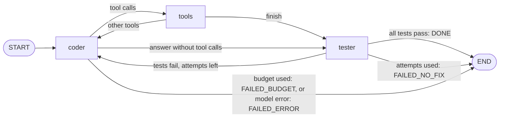

# Mergewright

Mergewright is a bounded coding agent. It reads a bug report for a Python repository, finds and edits the code with its tools, and proves the fix by running the repository's pytest suite. It is the CSE 510 (Fall 2026) final project.

The design of the full system (a durable issue-to-pull-request service), its evaluation plan and its milestones are in [docs/mergewright-spec.md](docs/mergewright-spec.md).

## Requirements

- Python 3.11 or later
- git
- Docker, running: the repository's tests always run in a sandbox container

The quick start needs no API key and no network access after setup.

## Setup

```bash
git clone https://github.com/akashkolte/Mergewright.git
cd Mergewright
python3 -m venv .venv
source .venv/bin/activate        # Windows: .venv\Scripts\activate
pip install -e ".[dev]"
docker build -t mergewright-python:1 docker/python   # the default sandbox image
```

Run every command below from the repository root, with the virtual environment active.

## Quick start: run the agent (no key needed)

```bash
mergewright run --llm replay
```

This runs the agent on the demo input: the repository [examples/buggy_calc](examples/buggy_calc) and the issue [examples/inputs/buggy_calc_issue.md](examples/inputs/buggy_calc_issue.md) (`median()` is wrong for an even number of values).

In replay mode the model's responses come from [examples/inputs/buggy_calc_replay.json](examples/inputs/buggy_calc_replay.json). Everything else is real: the graph runs, the tools search, read and edit the files, and `pytest` runs the repository's tests.

Expected output (abridged):

```
[llm]  step 1: ['search_code']
[tool] search_code({"pattern": "def median"}) -> ok
[llm]  step 2: ['read_file']
[tool] read_file({"path": "calc.py", "start": 11, "end": 16}) -> ok
[llm]  step 3: ['edit_file']
[tool] edit_file(...) -> ok
[llm]  step 4: final answer
[tool] run_tests({}) -> ok
[test] attempt 1: passed=6 failed=0
--- diff ---
...
--- status: DONE (all tests pass) ---
run log: runs/<run_id>/run.jsonl
```

The agent works on a copy in `runs/<run_id>/workspace`, so [examples/buggy_calc](examples/buggy_calc) keeps its bug and the run can be repeated.

## Live mode (real model)

Live mode calls a real model with the [`openai`](https://github.com/openai/openai-python) package. Any OpenAI-compatible chat server works, including the UB-hosted model (reachable only on the UB network or VPN).

1. Copy the settings template and fill it in:

   ```bash
   cp .env.example .env
   ```

   | Variable | Value |
   |---|---|
   | `MERGEWRIGHT_MODEL` | The model name as the server lists it, for example `zai-org/GLM-5.2` |
   | `MERGEWRIGHT_API_BASE` | The server's base URL, usually ending in `/v1` |
   | `MERGEWRIGHT_API_KEY` | The server's API key (leave empty if the server needs none) |

2. Run:

   ```bash
   mergewright run --llm live
   ```

To save the live responses so the same run can be replayed later, add `--record runs/my_replay.json`, then run `mergewright run --llm replay --replay-file runs/my_replay.json`.

### Your own input

`--repo` takes any directory that holds a Python package with a pytest suite, and `--issue` takes a text file with the bug report. Use live mode for your own input; the bundled replay file only fits the demo input.

```bash
mergewright run --llm live --repo path/to/repo --issue path/to/issue.md
```

## Eval tasks

Tasks live in `eval/tasks/<id>/` (`task.json`, the issue, the reference fix and the hidden tests). The splits and their frozen selection rules are in `eval/PLAN.md`: 5 local smoke tasks with recorded model responses, and 20 dev tasks from SWE-rebench. List the dev candidates in rule order, import one, check it, and list what you have:

```bash
mergewright tasks select --count 25
mergewright tasks import <instance-id> --split dev
mergewright tasks validate
mergewright tasks list
```

`validate` runs the task 3 times without and with the reference fix, in fresh sandboxes from the task's image (pinned by digest), and writes `validation.json`. A task is usable only if its fail-to-pass tests fail without the fix, everything passes with it, and no result changes between runs. SWE-rebench images are x86; on Apple Silicon they run under emulation.

## Run the tests

```bash
pytest
```

The tests marked `docker` (sandbox guards and the end-to-end runs) need Docker, the `mergewright-python:1` image and the spectree-64 fixture image; without them they are skipped. `pytest -m "not docker"` runs the others with a fake sandbox. The tests are deterministic and make no network or model calls. The demo repository's own test, which fails on purpose, is not part of this run.

## Workflow graph

The graph is a LangGraph `StateGraph`, defined in `build_graph()` in [src/mergewright/graph.py](src/mergewright/graph.py). Print it from the code with:

```bash
mergewright graph
```



| Node | What it does |
|---|---|
| `coder` | Sends the issue, the history and any test failures to the model, with the schemas of the Coder tools |
| `tools` | Validates and runs the tool calls the model asked for; any error goes back to the model as the tool's result |
| `tester` | The gate: runs the full test suite and decides: done, retry, or give up |

## Tools

All five tools belong to the Coder (the model). A call to any other tool is refused by code, not by the prompt.

| Tool | What it does | Limits |
|---|---|---|
| `search_code` | Regex search over the repository | 50 hits; invalid regex is an error result |
| `read_file` | Reads a line range with line numbers | 400 lines, 200 KB; path must stay inside the workspace |
| `edit_file` | Replaces one exact occurrence of a text | Test files, `conftest.py`, pytest config (`pytest.ini`, `pyproject.toml`, `setup.cfg`, `tox.ini`), `.git` and `.github` are protected |
| `run_tests` | Runs chosen existing tests (by id) in the sandbox and returns a structured report | Ids that start with `-` are refused; same timeout and sandbox limits as the gate |
| `finish` | Ends the Coder's turn; the graph goes to the tester | None |

The tester runs the full suite in the sandbox (no network, non-root, resource limits, no host environment). Tests known to fail at the task's base commit do not block `DONE`. A new failure is re-run alone once; only a repeat failure blocks.

## Run limits

Set in `Limits` in [src/mergewright/config.py](src/mergewright/config.py): 50 model calls, 3 gate test runs, 15 minutes per test run, 120 s per model call, 90 minutes per run (a safety stop; the step limit should end a run first). A run that hits a limit ends with `FAILED_BUDGET` or `FAILED_NO_FIX`. The exit code is 0 for `DONE`, 1 for a failed run and 2 for a configuration error.

## Run log

Each run writes `runs/<run_id>/run.jsonl`, one JSON object per line. Events: `run_started`, `llm_call` (step, tool calls, tokens, seconds), `tool_call` (agent, tool, arguments, ok, output, seconds), `test_result`, `llm_error` and `run_finished` (status, reason, diff). `runs/` is git-ignored.

## Repository layout

| Path | Contents |
|---|---|
| `src/mergewright/` | The agent (`graph.py`, `tools.py`, `llm.py`, `prompts.py`, `runner.py`), the sandbox (`sandbox/`, `environments.py`), tasks and oracle (`tasks.py`, `oracle.py`, `selection.py`), evaluation and reports (`evaluation.py`, `report.py`, `stats.py`) and the command line (`__main__.py`) |
| `tests/` | The project's tests; shared fakes and fixtures in `tests/fakes.py` |
| `eval/` | Tasks (`eval/tasks/`) and the eval plan (`eval/PLAN.md`) |
| `results/` | Committed eval results cited in the plans |
| `docker/`, `scripts/` | The sandbox image and the cloud setup and eval scripts |
| `examples/` | Demo repository with one bug, its issue text and the replay file |
| `docs/` | Specification, agenda, phase plans and spike results |
| `presentation/` | Proposal slide deck and the script that builds it |

The current build state is in [CLAUDE.md](CLAUDE.md) ("Current state").

## Limitations

- Tests run in a Docker container with no network, a non-root user and resource limits, but containers share the host kernel; gVisor comes later (spec Phase 7). The file tools read and edit the workspace on the host.
- `mergewright run` decides `DONE` with the repository's own tests, which the agent can read. `mergewright eval` grades with the hidden-test oracle.
- The bundled replay file was written by hand to match the demo input. Record your own with `--record` from a live run.
- One agent (the Coder) and a test loop. Temporal, the approval gate and GitHub integration come in later phases (`docs/agenda.md`).
