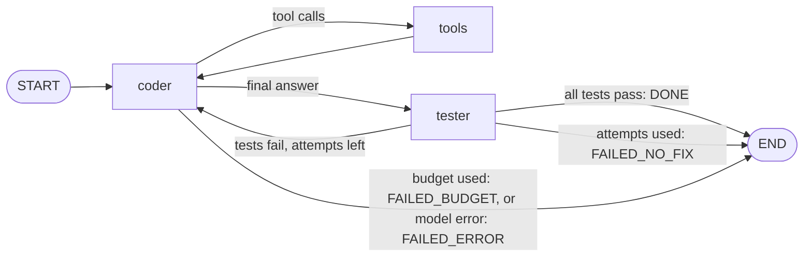

# Mergewright

Mergewright is a bounded coding agent. It reads a bug report for a Python repository, finds and edits the code with its tools, and proves the fix by running the repository's pytest suite. It is the CSE 510 (Fall 2026) final project.

The long-term design (a durable issue-to-pull-request service) is in [docs/proposal.md](docs/proposal.md) and [docs/architecture.md](docs/architecture.md). This milestone's plan is in [docs/checkpoint.md](docs/checkpoint.md).

## Requirements

- Python 3.11 or later
- git

The quick start needs no API key and no network access after `pip install`.

## Setup

```bash
git clone https://github.com/akashkolte/Mergewright.git
cd Mergewright
python3 -m venv .venv
source .venv/bin/activate        # Windows: .venv\Scripts\activate
pip install -e ".[dev]"
```

Run every command below from the repository root, with the virtual environment active.

## Quick start: run the agent (no key needed)

```bash
mergewright run --llm replay
```

This runs the agent on the demo input: the repository [examples/buggy_calc](examples/buggy_calc) and the issue [examples/inputs/buggy_calc_issue.md](examples/inputs/buggy_calc_issue.md) (`median()` is wrong for an even number of values).

In replay mode the model's responses come from [examples/inputs/buggy_calc_replay.json](examples/inputs/buggy_calc_replay.json). Everything else is real: the graph runs, the tools search, read and edit the files, and `pytest` runs the repository's tests.

Expected output (abridged):

```
[llm]  step 1: ['search_code']
[tool] search_code({"pattern": "def median"}) -> ok
[llm]  step 2: ['read_file']
[tool] read_file({"path": "calc.py", "start": 11, "end": 16}) -> ok
[llm]  step 3: ['edit_file']
[tool] edit_file(...) -> ok
[llm]  step 4: final answer
[tool] run_tests({}) -> ok
[test] attempt 1: passed=6 failed=0
--- diff ---
...
--- status: DONE (all tests pass) ---
run log: runs/<run_id>/run.jsonl
```

The agent works on a copy in `runs/<run_id>/workspace`, so [examples/buggy_calc](examples/buggy_calc) keeps its bug and the run can be repeated.

## Live mode (real model)

Live mode calls a real model with the [`openai`](https://github.com/openai/openai-python) package. Any OpenAI-compatible chat server works, including the UB-hosted model (reachable only on the UB network or VPN).

1. Copy the settings template and fill it in:

   ```bash
   cp .env.example .env
   ```

   | Variable | Value |
   |---|---|
   | `MERGEWRIGHT_MODEL` | The model name as the server lists it, for example `zai-org/GLM-5.2` |
   | `MERGEWRIGHT_API_BASE` | The server's base URL, usually ending in `/v1` |
   | `MERGEWRIGHT_API_KEY` | The server's API key (leave empty if the server needs none) |

2. Run:

   ```bash
   mergewright run --llm live
   ```

To save the live responses so the same run can be replayed later, add `--record runs/my_replay.json`, then run `mergewright run --llm replay --replay-file runs/my_replay.json`.

### Your own input

`--repo` takes any directory that holds a Python package with a pytest suite, and `--issue` takes a text file with the bug report. Use live mode for your own input; the bundled replay file only fits the demo input.

```bash
mergewright run --llm live --repo path/to/repo --issue path/to/issue.md
```

## Run the tests

```bash
pytest
```

Expected: `59 passed`. The tests are deterministic and make no network or model calls: they use a scripted model and temporary copies of the demo repository. The demo repository's own test, which fails on purpose, is not part of this run.

| File | What it tests |
|---|---|
| [tests/test_tools.py](tests/test_tools.py) | Each tool, its error cases, the path guard, the edit protections and the tool registry |
| [tests/test_graph.py](tests/test_graph.py) | The graph: fix path, test-failure loop, step and wall-clock caps, bad tool calls, model failure |
| [tests/test_cli.py](tests/test_cli.py) | The command line, end to end in replay mode |
| [tests/test_runner.py](tests/test_runner.py) | The workspace copy: a symlink in the repository cannot bring outside files into the workspace |
| [tests/test_config_and_llm.py](tests/test_config_and_llm.py) | Settings, the live model client (with a fake OpenAI client), error handling, record and replay |

## Workflow graph

The graph is a LangGraph `StateGraph`, defined in `build_graph()` in [src/mergewright/graph.py](src/mergewright/graph.py). Print it from the code with:

```bash
mergewright graph
```



| Node | What it does |
|---|---|
| `coder` | Sends the issue, the history and any test failures to the model, with the schemas of the three Coder tools |
| `tools` | Validates and runs the tool calls the model asked for; any error goes back to the model as the tool's result |
| `tester` | Runs the test suite with `run_tests` and decides: done, retry, or give up |

## Tools

| Tool | Used by | What it does | Limits |
|---|---|---|---|
| `search_code` | Coder (model) | Regex search over the repository | 50 hits; invalid regex is an error result |
| `read_file` | Coder (model) | Reads a line range with line numbers | 400 lines, 200 KB; path must stay inside the workspace |
| `edit_file` | Coder (model) | Replaces one exact occurrence of a text | Test files, `conftest.py`, pytest config (`pytest.ini`, `pyproject.toml`, `setup.cfg`, `tox.ini`), `.git` and `.github` are protected |
| `run_tests` | Tester node | Runs `pytest` and returns a structured report | 60 s timeout; the subprocess gets no API keys or other secrets |

The model is offered only the three Coder tools. A call to any other tool is refused by code, not by the prompt.

## Run limits

Set in `Limits` in [src/mergewright/config.py](src/mergewright/config.py): 25 model calls, 3 test runs, 60 s per test run, 120 s per model call, 5 minutes per run. A run that hits a limit ends with `FAILED_BUDGET` or `FAILED_NO_FIX`. The exit code is 0 for `DONE`, 1 for a failed run and 2 for a configuration error.

## Run log

Each run writes `runs/<run_id>/run.jsonl`, one JSON object per line. Events: `run_started`, `llm_call` (step, tool calls, tokens, seconds), `tool_call` (agent, tool, arguments, ok, output, seconds), `test_result`, `llm_error` and `run_finished` (status, reason, diff). `runs/` is git-ignored.

## Repository layout

| Path | Contents |
|---|---|
| `src/mergewright/` | The agent: `graph.py` (workflow graph), `tools.py`, `llm.py`, `prompts.py`, `runner.py`, `runlog.py`, `config.py`, `__main__.py` (command line) |
| `tests/` | The project's tests |
| `examples/buggy_calc/` | Demo repository with one bug and its pytest suite |
| `examples/inputs/` | Demo issue text and the replay file |
| `docs/` | Proposal, architecture, checkpoint plan |
| `presentation/` | Proposal slide deck and the script that builds it |

## Limitations

- `run_tests` runs `pytest` as a local subprocess in the run's workspace, with a reduced environment and a timeout. That is not isolation. Run the agent only on repositories you trust. Later milestones move execution into E2B sandboxes.
- The tests that decide `DONE` are the repository's own tests, which the agent can read. `edit_file` blocks edits to tests and pytest config, but a fix could still special-case the tested inputs. The full system grades with hidden tests.
- The bundled replay file was written by hand to match the demo input. Record your own with `--record` from a live run.
- This milestone has one agent (the Coder) and a test loop. The Planner and Reviewer agents, Temporal, the approval gates and GitHub integration come in later milestones.
