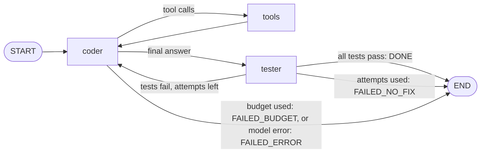

# Mergewright: Checkpoint plan (Milestone 2)

**Check-off:** Wed 11 Nov 2026, 5:40–6:15 pm · 10 points · 10% of the project grade
**Rubric:** "Checkpoint check-off rubric" (CSE 410/510, Milestone 2)
**Status:** Phases 1–5 built (10 Nov 2026). Waiting for team review, then commit and push. See §12.
**Submission cut-off:** Tue 10 Nov 2026, midnight (confirmed by the team).

---

## 1. Goal

Push one commit to `main` that the instructors can clone and run on a clean machine. The commit must contain:

1. An agent that runs end to end on one input and reaches an answer.
2. At least two tools. The run calls each tool, and each tool has tests.
3. A workflow graph defined in code.
4. At least 10 test cases.
5. A `README.md` whose setup steps work exactly as written.
6. A clean repository: no secrets, no venvs or caches, no notebooks, a clear layout.

This is **not** the full system in `docs/mergewright-spec.md`. It is the smallest piece of it that scores 10/10, built so that the later work reuses it unchanged.

## 2. Rubric mapping

| Rubric item | Points | How this plan meets it | Evidence at the table |
|---|---|---|---|
| A1. Runs live on one input, end to end | 2 | `mergewright run --llm live` on the bundled `examples/buggy_calc` repo and its issue, with the UB-hosted model. The agent edits the code and the repo's tests pass. | Terminal shows status `DONE`, the diff and `passed=6 failed=0` |
| A2. At least two tools, each called and tested | 2 | Four tools: `read_file`, `search_code`, `edit_file`, `run_tests`. Each has its own tests. | Console and `runs/<run_id>/run.jsonl` show each `tool_call`; `tests/test_tools.py` |
| A3. Workflow graph defined in code | 1 | LangGraph `StateGraph` in `build_graph()`, `src/mergewright/graph.py`. `mergewright graph` prints it from the code as Mermaid. | Open `graph.py` and the Mermaid output |
| A4. At least 10 test cases | 1 | 54 tests (§5). | `pytest` prints `54 passed` |
| B1. README setup works | 2 | The README is tested on a fresh clone in an empty directory. The replay mode needs no API key. | Graded from the commit |
| B2. Repository is clean | 2 | `.gitignore`, `.env.example`, a secret scan before push, no notebooks, a clear `src/` layout. | Graded from the commit |

## 3. Scope

### In scope

- One LangGraph graph: the Coder ⇄ Tester loop. This is "option 2" from the design review. LangGraph owns the agent loop *inside* one step. Later, Temporal runs this graph as an activity, and the graph code does not change.
- Four tools with per-tool input validation and a path guard.
- Two LLM modes behind one interface:
  - `live`: a real model through the `openai` package, on any OpenAI-compatible chat server. The model, base URL and key come from `.env`. The team uses the UB-hosted model `zai-org/GLM-5.2`.
  - `replay`: recorded responses from `examples/inputs/buggy_calc_replay.json`. No key, no network, deterministic.
- A JSONL run log and readable console output.
- Hard bounds: max LLM steps, max test attempts, a timeout per tool call, and a wall-clock limit.

### Out of scope (later milestones, see the spec)

Temporal, FastAPI, webhooks, Postgres, E2B, GitHub writes, the approval gates, the Planner and Reviewer agents, retrieval, observability, the eval harness and fault injection.

### Honesty notes (put these in the README)

- **Sandbox:** `run_tests` runs `pytest` as a local subprocess in a temporary copy of the bundled example, with a scrubbed environment and a timeout. This is **not** isolation. It is acceptable only because the input is a bundled repo that we wrote. E2B replaces it later behind the same interface.
- **Replay mode** drives the real graph and the real tools: real file edits and a real `pytest` run. Only the model's responses come from a recording. State this plainly in the README and at the table.

## 4. Design

### 4.1 Layout

```
pyproject.toml              # deps pinned; `mergewright` command; pytest testpaths = ["tests"]
README.md
.env.example                # placeholders only
.gitignore
src/mergewright/
  __main__.py               # CLI: `run`, `graph`
  config.py                 # Limits; reads env and .env, validates, fails fast
  llm.py                    # LLMClient protocol; OpenAIClient; ScriptedLLM; RecordingLLM
  tools.py                  # 4 tools + registry (allow-list, JSON schemas, validation)
  graph.py                  # AgentState, nodes, routing, build_graph()
  runner.py                 # one run: workspace copy, graph invoke, diff
  prompts.py                # Coder prompts
  runlog.py                 # JSONL run log + console output
examples/buggy_calc/        # demo repo: small package with one bug
  calc.py
  pytest.ini                # makes the demo its own pytest root
  tests/test_calc.py        # one test fails until the bug is fixed
examples/inputs/
  buggy_calc_issue.md       # the issue text given to the agent
  buggy_calc_replay.json    # model responses for replay mode
tests/
  conftest.py               # buggy_calc / fixed_calc fixtures
  test_tools.py
  test_graph.py
  test_cli.py
  test_config_and_llm.py
docs/checkpoint.md          # this file
```

**Pitfall:** the example's test fails on purpose. `pyproject.toml` sets `testpaths = ["tests"]`, or the project's own `pytest` run would collect it and report a failure.

**Why the issue and replay file are outside `examples/buggy_calc`:** the agent works on a copy of that directory. The replay file holds the fix, so it must not be readable by the agent.

### 4.2 Workflow graph



| Node | Does | LLM? |
|---|---|---|
| `coder` | Checks the step and wall-clock caps. Sends the issue, the history and the last test failures to the model, with the schemas of the Coder's three tools. Returns tool calls, or a final message. | Yes |
| `tools` | Runs each requested tool through the registry. A tool that is not on the Coder's allow-list, or that has invalid arguments, returns an error message to the model. It does not crash the run. | No |
| `tester` | Calls `run_tests` and routes on the result. | No |

`runner.run_agent()` copies the target repo to `runs/<run_id>/workspace` before the graph starts, so the example stays unchanged between runs. (The plan had a `setup_workspace` node; it moved out of the graph because the tools need the workspace path before the graph is built.)

`AgentState` (typed): `messages`, `steps`, `test_attempts`, `status`, `reason`.

**Bounds** (defaults in `config.py`): 25 LLM steps, 3 test attempts, 60 s per tool call, 120 s per LLM call, 5 min wall clock.

### 4.3 Tools

| Tool | Input | Output | Errors handled |
|---|---|---|---|
| `read_file` | `path`, optional `start`/`end` lines | File text with line numbers, truncated at a size cap | Not found; path outside the workspace; binary or too large |
| `search_code` | `pattern`, optional `glob` | `[{path, line, text}]`, capped at N hits | Invalid regex; no matches (empty list, not an error) |
| `edit_file` | `path`, `old`, `new` | The changed lines | `old` not found; `old` found more than once; path outside the workspace; denied path (`.git/`, `.github/`) |
| `run_tests` | none | `{passed, num_passed, num_failed, num_errors, failures[], timed_out, log_tail}` | Timeout (returned as a result, not raised); collection error |

- Only the `tester` node calls `run_tests`. The model is offered `read_file`, `search_code` and `edit_file` only.
- `edit_file` also refuses test files (`tests/`, `test_*.py`, `conftest.py`), so the model cannot make the tests pass by changing them.
- All paths are resolved, then checked to be inside the workspace. This blocks `..`, absolute paths and symlink escape.
- `search_code` is pure Python (`os.walk` + `re`), so the instructors do not need `ripgrep`.
- `edit_file` uses exact string replacement, not unified diffs. Models produce exact-match edits more reliably.

### 4.4 Run log

`runs/<run_id>/run.jsonl` gets one JSON line per event: `run_started`, `llm_call` (model, tokens, latency), `tool_call` (name, args, result summary, duration, ok/error), `test_result`, `run_finished` (status, diff stats). The console prints the same events in short form, then the final diff. `runs/` is git-ignored.

## 5. Tests (54, all deterministic, no network)

Tests use a scripted model (`ScriptedLLM`), a fake object in place of the `openai` SDK client, and temporary copies of `examples/buggy_calc`. No test calls a real model. Counts are pytest test cases (parametrized cases count separately).

| File | Cases | What it covers |
|---|---|---|
| `tests/test_tools.py` | 29 | `read_file`: line range, missing file, 3 path-traversal forms, symlink escape, truncation. `search_code`: match, no match, invalid regex. `edit_file`: unique match, not found, ambiguous, outside workspace, 4 protected paths (`tests/`, `.github/`, `.git/`, `conftest.py`). `run_tests`: failing names on the buggy repo, pass after the fix, timeout as a result, no secrets in the subprocess (canary env var). Registry: unknown tool, allow-list, 3 invalid-argument forms, tool error as result, schemas. |
| `tests/test_graph.py` | 11 | Fix path to `DONE` (and which tools ran); test failure loops back to `coder` with the failing test names; `FAILED_NO_FIX` after 3 attempts; step cap and wall-clock cap give `FAILED_BUDGET`; unknown tool, malformed arguments and a disallowed tool are reported to the model and the run continues; a model failure gives `FAILED_ERROR`; the model is offered only the Coder tools; exact nodes and edges of the graph. |
| `tests/test_cli.py` | 5 | Replay run exits 0 and logs a `tool_call` for all four tools; the example repo is unchanged after a run; live mode with no model fails fast with exit 2; missing issue file is a clear error; `graph` prints Mermaid. |
| `tests/test_config_and_llm.py` | 9 | `.env` loading; live settings need a model; settings for an OpenAI-compatible server; OpenAI client sends the model name, tools and temperature and parses tool calls; SDK configured with base URL, key, timeout and retries; SDK errors become `LLMError`; a response with no choices is an `LLMError`; record then replay returns the same responses; scripted model fails when it runs out. |

## 6. Work plan (24 hours, two people)

This is the original schedule. Its test numbers refer to the first draft of §5; §12 records what was built.

Push to `main` at the end of each phase, after a fresh-clone check. If time runs out, the last good push is still a passing checkpoint.

| Phase | Hours | Work | Owner (suggested) | Done when |
|---|---|---|---|---|
| 0 | 0–0.5 | Confirm the deadline. Approve the dependencies (§7). Choose the provider and model for live mode. | Both | Decisions written into §9 |
| 1 | 0.5–2 | `pyproject.toml`, `.gitignore`, `.env.example`, package skeleton, `examples/buggy_calc`, a first README. Push. | Akash | Fresh clone installs and `pytest` runs |
| 2a | 2–6 | `tools.py` + tests 1–15. `runlog.py`. `config.py` + test 24. | Akash | Tool tests pass |
| 2b | 2–6 | `llm.py` (protocol, live client, replay client). `graph.py` + `prompts.py`. Tests 16–22 with the scripted LLM. | Sheetal | Graph tests pass |
| 3 | 6–9 | CLI (`run`, `graph`). Wire everything together. Tests 23 and 25. | Akash | `run --llm replay` reaches `DONE` |
| 4 | 9–12 | Live run on the example with a real key. Tune the prompt until the run reaches `DONE` 3 times in a row. Record the demo cassette from a real live run. Push. | Sheetal | Live and replay both reach `DONE` |
| 5 | 12–14 | Finish the README. Add the Mermaid graph to the README. `ruff check` and `ruff format`. Optional: a GitHub Actions job for ruff and pytest. | Akash | Lint clean |
| 6 | 14–16 | Release check (§8) on a fresh clone, ideally on the other teammate's machine. Push the final commit. | Both | Every box in §8 is ticked |
| — | 16–24 | Buffer. Do not add features. | — | — |

## 7. Dependencies (need approval before Phase 1)

| Package | Why | Alternative |
|---|---|---|
| `langgraph` | The workflow graph (rubric A3) and the planned agent loop | A hand-written state machine; it also passes A3, but drops LangGraph from the design |
| `openai` | Live mode on any OpenAI-compatible server, such as the UB-hosted model. Replaced `litellm` on 10 Nov (§12) | `litellm`: the planned gateway for the full system, but it needs a provider prefix on the model name and is a much larger install |
| `pydantic` | Typed state and validated tool arguments | dataclasses plus manual checks |
| `pytest` (dev) | Tests | — |
| `ruff` (dev) | Lint and format | — |

Pin exact versions in `pyproject.toml` at install time. Python 3.11 or later.

## 8. Release check (run before the final push)

- [x] Fresh copy of only tracked and non-ignored files in an empty directory; README followed word for word (10 Nov, see §12). Repeat with a real `git clone` after the push.
- [x] `pytest` prints `54 passed`, 0 failed.
- [x] The replay run reaches `DONE` with no `.env` file present.
- [ ] **The live run reaches `DONE` with the UB-hosted model.** Not yet run: needs the UB network and the endpoint details.
- [x] `mergewright graph` prints the Mermaid graph.
- [x] No `.env`, `.venv`, `__pycache__`, `.pytest_cache`, `runs/`, `.DS_Store`, notebooks or large stray files would be committed.
- [x] Secret scan of the files to be committed finds nothing.
- [x] `.env.example` holds placeholders only.
- [x] `CLAUDE.md` "Current state" updated.
- [ ] The commit is on `main` on GitHub, not only local. Waiting for team review.

## 9. Check-off script (5 minutes, Wednesday)

Before you sit down: be on the UB network, open a terminal in the repo root with the venv active and `.env` filled in, and open `src/mergewright/graph.py` and `tests/test_tools.py` in an editor. Do one live run just before your slot, so a fresh `runs/<run_id>/run.jsonl` is ready to open. The rubric asks for the agent "already running, started from the repository": start the live command from this terminal, not from a notebook.

1. **0:00–1:30. Live run (A1, A2).** `mergewright run --llm live`. As lines print, point at each `[tool]` line (`search_code`, `read_file`, `edit_file`, then `run_tests`), then `DONE` and the diff.
2. **1:30–2:15. Run log.** Open the new `runs/<run_id>/run.jsonl`. Show one `tool_call` line for each tool, with its arguments and result.
3. **2:15–3:15. Tests (A2, A4).** `pytest`: show `54 passed`. In `test_tools.py`, show one test group per tool.
4. **3:15–4:15. Graph (A3).** Show `build_graph()` in `graph.py`, then `mergewright graph`.
5. **4:15–5:00. Questions.** Likely ones: why the model cannot call `run_tests` (allow-list in code); what stops a loop (step, attempt and wall-clock caps); why the tests cannot be edited (`edit_file` protection).

**Fallback:** if the UB endpoint is down, run `mergewright run --llm replay`. It shows the same path with real tools, but expect the "partial" score for A1.

## 10. Risks

| Risk | Mitigation |
|---|---|
| **The UB endpoint does not support OpenAI tool calling** (an OpenAI-compatible server can serve chat but reject or ignore `tools`) | Test today on the UB network (§12 next steps). If it fails, add a JSON-action fallback: the model returns `{"tool": ..., "args": ...}` as text and the `coder` node parses it. About an hour of work. |
| The live model skips `search_code` or `read_file` | The prompt asks for search, then read, then edit. Do 3 live runs before the check-off and check the log. `edit_file` and `run_tests` are always called, so the rubric's "two tools" is met even then. |
| The instructors have no UB access or key | Replay mode needs no key or network, and it is the README quick start |
| The README works only on our machines | Fresh-copy check done; repeat with `git clone` after the push, ideally on the other teammate's machine |
| The project's `pytest` collects the example's failing test | `testpaths = ["tests"]` in `pyproject.toml`, `pytest.ini` in the example; `test_cli.py` covers the full run |
| A stray-file judgment on `presentation/MergeWright_Project_Proposal.pptx` (1 MB) | It is the Milestone 1 deliverable in its own folder, described in the README layout table. Low risk. |

## 11. Open decisions

1. ~~Submission cut-off~~: Tue 10 Nov, midnight.
2. ~~Live-mode model~~: the UB-hosted model `zai-org/GLM-5.2`, through its OpenAI-compatible API.
3. Whether to commit `docs/mergewright-spec.md`. `docs/architecture.md` already refers to it.
4. Whether to add a GitHub Actions job (ruff + pytest). Not added; optional after the deadline.
5. Whether to re-record `examples/inputs/buggy_calc_replay.json` from a real live run (`--record`). Recommended: it makes replay mode a true recording instead of a hand-written script.

## 12. Progress

### Decisions

- 10 Nov: dependencies in §7 approved. Pinned: `langgraph==1.2.20`, `litellm==1.108.4`, `pydantic==2.14.3`, `pytest==9.2.0`, `ruff==0.17.4`.
- 10 Nov: `litellm` replaced by `openai==3.49.0` for the checkpoint. The first live run failed because LiteLLM read `zai-org` in `zai-org/GLM-5.2` as a provider name. The `openai` SDK sends the model name as is, and it retries only connection errors, timeouts, 429 and 5xx, so a wrong model name or key fails at once instead of after 3 attempts. LiteLLM stays the planned gateway in the full design (`docs/proposal.md`).
- `examples/buggy_calc/pytest.ini` makes the example its own pytest root, so the project config (and the agent's workspace copies under `runs/`) never mix with the project's tests.
- The issue text and the replay file live in `examples/inputs/`, outside the repo the agent works on, because the replay file contains the fix.
- `setup_workspace` moved out of the graph into `runner.run_agent()` (§4.2).
- `edit_file` also protects test files, so a fix cannot pass by editing the tests.
- `run_tests` is called only by the `tester` node; the model is offered three tools.
- `.env` is parsed by a 15-line function in `config.py` instead of adding `python-dotenv`.

### Phases 1–5 (built 10 Nov, not pushed)

Phase 1: project skeleton, demo repo, first README. Phases 2–3: `config.py`, `tools.py`, `llm.py`, `prompts.py`, `runlog.py`, `graph.py`, `runner.py`, `__main__.py` and the four test files; `tests/test_example_repo.py` from Phase 1 was replaced by the `run_tests` tests. Phase 5: README rewritten, `CLAUDE.md` current state updated.

Validation, 10 Nov:

- `ruff check .` and `ruff format --check .`: clean.
- `pytest`: 52 passed.
- `mergewright run --llm replay`: `DONE` in 4 model steps and 1 test run; all four tools called; diff is the reference fix.
- `mergewright graph`: prints the Mermaid graph with nodes `coder`, `tools`, `tester`.
- Fresh-copy check: only the 35 files that would be committed, copied to an empty directory; README followed word for word on Python 3.12 and again on Python 3.13. Both: install works, replay run `DONE`, `52 passed`, `graph` prints, live mode without `.env` exits 2 with a clear message, the example keeps its bug. Python 3.11 (the stated minimum) was not available locally and is untested.
- Live-mode HTTP path, checked against a local fake OpenAI-compatible server (not the UB endpoint): LiteLLM sent `POST /v1/chat/completions` with model `GLM-5.2`, the three Coder tool schemas and a Bearer key; the run reached `DONE`; `--record` wrote a replay file that replayed to `DONE`.

Re-validation after the switch to `openai`, 10 Nov:

- `ruff check .` and `ruff format --check .`: clean. `pytest`: 54 passed.
- Fresh copy of the files to be committed (presentation excluded), README followed on Python 3.12: install pulls `openai` and not `litellm`; `54 passed`; replay run `DONE`; the example keeps its bug; live mode without `.env` exits 2.
- Live-mode HTTP path against the local fake OpenAI-compatible server: the `openai` SDK sent `POST /v1/chat/completions` with model `zai-org/GLM-5.2` (no prefix), the three Coder tool schemas and a Bearer key; the run reached `DONE`; the `--record` file replayed to `DONE`.
- Not yet run: live mode against the real UB endpoint.
- Secret scan of all files to be committed: no matches.

### Guard fixes after the submission (11 Nov)

- `edit_file` now also protects pytest config (`pytest.ini`, `pyproject.toml`, `setup.cfg`, `tox.ini`). Before, the agent could add `addopts = -k "not even"` to `pytest.ini` and the suite passed with the bug still in place.
- `runner.run_agent()` copies the repository with `symlinks=True`. Before, `shutil.copytree` copied the content of a symlink's target, so a symlink to a file outside the repository put that file's content in the workspace, where `read_file` could return it to the model.
- Regression tests: 4 new `edit_file` protection cases in `tests/test_tools.py`, and `tests/test_runner.py`. `pytest`: 59 passed.
- Live runs on 10 Nov (before the commit): 2 runs with `zai-org/GLM-5.2` reached `DONE` and called all four tools (4 model calls, about 4,000 tokens each).

### Next steps (before midnight)

1. Team review of the change.
2. On the UB network: fill in `.env`, run `mergewright run --llm live` 3 times, and check that each run reaches `DONE` and calls all four tools. Optionally re-record the replay file with `--record`.
3. Commit and push to `main`, then `git clone` into an empty directory and follow the README once more.
