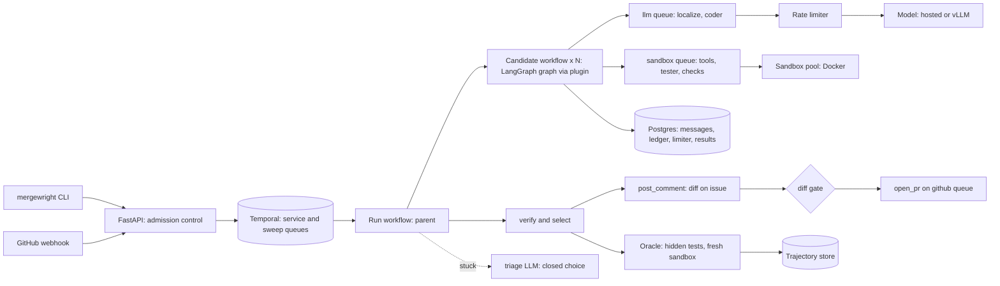

# Mergewright: a durable platform that runs, verifies and improves coding agents

**Origin:** CSE 510 Agentic AI Engineering (Fall 2026), University at Buffalo
**Status:** Spec v6 (replaces v5, 2026-11-13). v6 runs the LangGraph graph on Temporal's LangGraph plugin, with each node as an activity. The Milestone 1 proposal, the midterm architecture review and the checkpoint plan are in git history (`git show ff9bb5d:docs/<file>.md`). Where they differ, this spec wins. Build order: [agenda.md](agenda.md).

## 1. Thesis

Mergewright turns a GitHub issue on a Python repo with a pytest suite into a PR on `mergewright/<run-id>`: minimal diff, passing tests, rationale, run record. A human approves the diff before any code reaches GitHub (branch or PR). How a repo connects and how an issue becomes a run: Section 7.1.

The same system runs in three modes: **service** (issue → PR), **eval** (task → hidden-test verdict) and **sweep** (thousands of runs that produce verified trajectories). Sweeps feed model improvement; model improvement needs throughput; throughput must not break durability or budgets.

The agent is not the contribution. The contribution is the system around it, and each claim has a measurement:

| Claim | Evidence that proves it (Section 9) |
|---|---|
| **Durable:** survives worker, sandbox, database and limiter failures; never re-runs completed work; never duplicates a GitHub side effect | One graph on three runtimes under fault injection, also under load |
| **Bounded:** token, dollar, step and time budgets hold across crashes and retries | Budget-overrun count under crash loops, 429 storms and impossible tasks |
| **Scalable:** sustains high concurrency under provider rate limits, across hosts, without starving interactive runs | Saturation curves, limiter comparison, two-host scaling, named bottleneck |
| **Improves the model:** measured gains from tool design, test-time compute and, if justified, training | Paired deltas with intervals on a decontaminated held-out set |
| **Honest:** hidden-test oracle, post-release tasks, baselines, k runs, intervals, published failures | Generated tables that trace to result manifests |
| **Safe:** least privilege in code, isolated execution, no secrets in the sandbox, reward-hacking guards | Adversarial suite; tamper attempts blocked and counted |

Not a goal: beating frontier coding agents on resolve rate. Not built: a custom UI (Section 3).

## 2. Scope rules

- Work runs in **phases** (Section 13, step list in [agenda.md](agenda.md)). Each phase ends with generated tables and one resume-ready result. Do not start a phase until the previous one has its numbers.
- Phases 1–4 are the minimum credible project: eval core and baseline, agent features, durable core, throughput. Phase 5 (test-time compute, held-out run) makes it stand out. Phase 6 (training) runs only if the Phase 5 decision says go. Phase 7 adds outside validation.
- Build order (decided 2026-11-15): measure first, then build the agent against the measurement, then wrap the finished agent in the reliability layer. Build only as much harness as the next decision needs.
- If time runs short, cut P2, then P1. Never cut the oracle, the durability table, the statistics or the held-out freeze.
- Every new dependency needs approval when it is first added. Every item in Section 14 needs its trigger.
- Budget and training are decided after Phase 5 (Section 11).

## 3. Key decisions

| Decision | Choice | Why |
|---|---|---|
| Runtime | The LangGraph graph runs on **Temporal's LangGraph plugin** (`temporalio-langgraph`, Public Preview). Every node with I/O is an activity; conditional edges run in the workflow (Section 4.2) | One durability system; completed nodes never re-run; per-node timeouts and retries; LangGraph stays the way the agent is defined |
| Gate on the runtime | Phase 0 spike with five pass criteria (Section 4.2) | The plugin is in preview; the design depends on behavior we must see, not read |
| Fallback | Hand-written Temporal-native loop: same node functions, called as plain activities from workflow code | Node functions carry over; only the runtime module changes |
| Rejected | LangGraph inside one long activity with a Postgres checkpointer (v5) | Two state stores, up to one repeated LLM call per crash, and LLM and sandbox calls cannot be isolated on separate queues |
| Plugin isolation | Exact versions of `temporalio` and `temporalio-langgraph` pinned; all plugin code in `mergewright/runtime/temporal_graph.py`; node functions have no Temporal imports | Preview APIs change; a switch to the fallback touches one module |
| Messages | Message bodies in Postgres keyed by content hash; graph state and payloads carry hashes and counters only | Temporal payload and history limits; history stays small |
| Orchestration | Deterministic workflow code: parent workflow per run, child workflow per candidate, verifier and diff gate in the parent | Every routing decision follows from a typed result; an LLM router adds cost, randomness and an injection surface |
| Supervisor LLM | One bounded **triage** call at the stuck point only (Section 4.3); kept only if it beats the fixed router | Gives a tested answer to "is an LLM supervisor worth it?" |
| Workflow change safety | CI replays recorded workflow histories against every change; `patched()` only when a live run must survive a deploy | Edge functions are workflow code; non-determinism must fail the build, not a live run |
| Task queues | One queue per resource (`llm`, `sandbox`, `oracle`, `github`); workflow queues `service` and `sweep` | Pools scale and fail apart; a sweep cannot starve a user's run |
| Rate limiter | Own token-aware limiter (RPM and TPM per `provider:model`) with reservations and AIMD; state in Postgres | Temporal's task-queue rate limit counts activities, not tokens. Redis only on its Section 14 trigger |
| Temporal hosting | Tests: local dev server. Evals, load and multi-host tests: self-hosted Temporal + Postgres (docker compose) on x86 cloud VMs. Temporal Cloud ($150 credits): actions-per-run spike and one optional comparison | Self-hosting is free and gives operational evidence; Cloud credits are small |
| Sandbox | `Sandbox` interface, Docker backend on an x86-64 Linux host, warm pool per image | Benchmark tasks ship as x86 images; warm reuse removes cold-start cost |
| File tools vs execution | File tools work on a host workspace bind-mounted into the container; every command runs in the container | Keeps the existing tools and path guard. Reading and editing files is not execution |
| Model serving | Hosted OpenAI-compatible endpoint for early phases; self-hosted vLLM from Phase 5 | Self-hosting pins exact weights and enables prefix-cache measurements |
| Headline benchmark | Post-release SWE-rebench Python tasks with their published images, plus our own mined dev set | SWE-bench Verified is contaminated and has flawed tests; OpenAI stopped reporting it on 2026-02-23 |
| Benchmark tooling | Reuse SWE-rebench task format and images; write only the runner, oracle and report | Building environments per repo is the largest hidden cost in agent evals |
| Model improvement | Scaffold and context first (Phase 2), test-time compute next (Phase 5); training only after the Phase 5 decision | Shows improvement without GPU cost; training is the riskiest step |
| LLM client | Keep the `openai` SDK against OpenAI-compatible servers; retries, fallback, limiter and budget ledger in our code | Works today; LiteLLM is in Section 14 with a trigger |
| User interface | No custom UI. Temporal UI, one Grafana dashboard, the `mergewright` CLI, generated Markdown reports, and GitHub comments or the CLI for approval | UI work adds no evidence for any claim in Section 1 |
| CI gate | Replay, workflow-replay, durability and limiter suites gate merges; live evals are reported, not gating | Live evals are too noisy to block merges |
| Build process | AI-assisted code is allowed; the core (runtime module, workflows, budget ledger, limiter, `post_comment`, `open_pr`, oracle, statistics) is test-first and reviewed line by line | Every core line must be explainable in an interview. AI use is disclosed in the README |

## 4. Architecture



### 4.1 Responsibilities

| Concern | Responsible part |
|---|---|
| Lifecycle: retries, timeouts, failover, cancel, human wait (signal + timer), budgets | Temporal (parent and candidate workflows) |
| Agent definition: nodes, typed state, conditional edges | LangGraph graph, executed by the plugin |
| Durable record of completed nodes | Temporal workflow history (no LangGraph checkpointer in the core) |
| Message bodies | Postgres message store |
| Running repo code and tests | Sandbox pool |
| Model call admission (RPM, TPM, concurrency) | Rate limiter |
| Choosing one patch among candidates | Verifier stage in the parent workflow |
| GitHub writes | `post_comment` and `open_pr` activities only, both idempotent |
| Truth about what exists on GitHub | GitHub, not our database |

Every LLM call, sandbox command, limiter call, GitHub call, clock read and random value runs in an activity. Workflow code and edge functions stay deterministic.

### 4.2 Execution model

- **Nodes:** `localize` and `coder` are activity nodes on the `llm` queue; `tools`, `tester` and `checks` are activity nodes on the `sandbox` queue. Each sets `execute_in: activity` with its own timeout and Temporal `RetryPolicy`. Conditional edges (`after_coder`, `after_tester`) run in the workflow, are `async`, and read state only. Nodes are module functions or methods of a class that holds their dependencies: the plugin rejects closures and wraps nodes in place, so each worker process uses one plugin instance.
- **State:** `{message_hashes, patch_hash, steps, test_attempts, tokens, status, reason, wants_tools}`. Nodes read and write message and patch bodies through the message store. `wants_tools` is the coder's routing flag, since edges cannot read messages. Payloads grow by one hash per message; if load tests show this matters, carry one conversation hash instead.
- **Sandbox invariant:** working tree = `base_sha` + patch. Every sandbox activity starts by checking the tree hash against the state; on mismatch or a lost sandbox, it resets to `base_sha` and applies the patch.
- **At-least-once nodes:** a timed-out attempt keeps running while its retry starts. Node side effects are idempotent or guarded: sandbox activities check the invariant above, heartbeat, and kill their container on timeout or cancellation.
- **History bound:** each candidate workflow continues-as-new with the carried state after each test attempt, so no completed node re-runs. The plugin's `cache()` is not used.
- **Budget ledger:** before each LLM call, the `coder` activity writes a reservation (`max_tokens`) to the Postgres ledger; after the call it settles the actual tokens. A retried attempt counts unsettled reservations of earlier attempts as spent, including a timed-out attempt that is still running. The ledger can over-count after a crash; it never under-counts. A run's budget covers all N candidates; each gets budget / N.
- **Spike gate (Phase 0, on `buggy_calc`).** Passed 2026-11-13; results in `docs/spikes.md`. All five must pass:
  1. A worker killed mid-run resumes without re-running any completed node.
  2. LLM nodes and sandbox nodes run on different task queues.
  3. State holds hashes only, and history stays bounded with continue-as-new.
  4. `interrupt()` in an activity node resumes from a Temporal signal (needed for in-graph pauses; the diff gate itself is a signal + timer in the parent).
  5. Per-node timeouts and retries come from Temporal's `RetryPolicy`.

  If criterion 2 fails, decide between the fallback (Section 3) and a shared queue with the limiter as the only control. If any other criterion fails, use the fallback.

### 4.3 Run flow

```
parent: prepare → start N candidate workflows → verify and select → checks
candidate: localize → coder ⇄ tools → tester → (fail, attempts left) → coder …
  ├ service mode: post_comment (diff) → diff gate (signal + 72 h timer) → open_pr → PR_OPENED
  ├ eval mode:    export patch → oracle → EVAL_DONE
  └ sweep mode:   export all candidates → oracle → trajectory store → EVAL_DONE
stuck (2 failed test attempts, or checks fail twice) → triage or stop
budget spent → FAILED_BUDGET · any terminal state → cleanup
```

N = 1 is the default. Terminal states: `PR_OPENED`, `EVAL_DONE`, `REJECTED`, `EXPIRED`, `CANCELLED`, `FAILED_NO_FIX`, `FAILED_BUDGET`, `FAILED_POLICY`, `FAILED_INFRA`, `FAILED_ERROR`. `FAILED_INFRA` (sandbox, image, host or limiter timeout) is reported apart from agent failures.

**Triage:** one LLM call that sees the issue, localization, last test report and check findings, and returns one of `{re_localize, continue_patching, write_repro_test, give_up}` with a reason. Code validates the choice against budgets and allowed transitions; an invalid choice falls back to the fixed rule.

### 4.4 Agents, checks and verifier

| Component | LLM | Tools / input | Output | Priority |
|---|---|---|---|---|
| Localizer | 1 call | repo map, `search_code`, `read_file` | files, symbols, hypothesis (schema-validated) | P0 |
| Coder | loop | `read_file`, `search_code`, `edit_file` (parse-checked), `run_tests(test_ids)` | edits | P0 (exists, tools change) |
| Tester gate | no | `run_tests` (in the sandbox) | `TestReport`; passes when no test fails and nothing new errors. Test files that already error at base (e.g. a dependency the task image lacks) are ignored; tests that fail at base are not | P0 (exists) |
| Checks | no | diff, ruff, tamper detector | blocking findings | P0 |
| Reproducer | loop | `read_file`, `write_new_test` (`tests/test_mergewright_repro_*.py` only) | test that fails on base, passes on patch | P1 |
| Verifier | staged | candidates, visible tests, repro tests | ranked candidates (Section 6.2) | P1 |
| Triage Supervisor | 1 call | see Section 4.3 | closed choice | P1 |
| LLM Reviewer | 1 call | diff, findings | approve / issues | Section 14 |

**Tamper detector:** blocks edits to protected paths (the Reproducer's own `tests/test_mergewright_repro_*.py` are allowed), new `skip`/`xfail`, new `conftest.py`, non-test code that branches on `pytest`/`PYTEST_CURRENT_TEST`/`sys.modules`, deleted assertions. Each attempt is logged with the diff hunk and counted. If training happens, it is also a negative reward signal (Section 6.3).

### 4.5 Interfaces (contracts to build against)

```python
class Sandbox(Protocol):
    def reset(self, base_sha: str, patch: str) -> None: ...  # enforces the Section 4.2 invariant
    def exec(
        self, argv: list[str], timeout_s: float
    ) -> ExecResult: ...  # exit code, output tail, timed_out
    def diff(self) -> str: ...  # git diff base_sha
    def close(self) -> None: ...  # idempotent


class SandboxPool(Protocol):
    def acquire(self, image: str, lease_ttl_s: float) -> Sandbox: ...  # warm if available
    def release(self, sandbox: Sandbox, healthy: bool) -> None: ...  # unhealthy → destroy


class MessageStore(Protocol):
    def put(self, body: dict) -> str: ...  # returns content hash; idempotent
    def get_many(self, hashes: list[str]) -> list[dict]: ...


class RateLimiter(Protocol):
    def reserve(
        self, key: str, tokens: int, timeout_s: float
    ) -> Reservation: ...  # 1 request + tokens; raises LimitTimeout
    def settle(
        self, reservation: Reservation, actual_tokens: int
    ) -> None: ...  # refund unused tokens
    def report_throttle(
        self, key: str, retry_after_s: float | None
    ) -> None: ...  # 429 feedback for AIMD


class Verifier(Protocol):
    def rank(self, task: TaskContext, candidates: list[Candidate]) -> list[RankedCandidate]: ...
```

`eval/tasks/<id>/task.json` (JSON: standard library only): `id`, `source` (mined | swe-rebench | swe-gym | adversarial | local), `split` (smoke | train | dev | held-out | adversarial), `repo`, `base_sha`, `image` (by digest), `repo_dir` (repo path in the image, e.g. `/testbed`), `issue` (file), `f2p` and `p2p` (test IDs), `gold_patch` (file), `test_patch` (file; the hidden tests, never shown to the agent), `test_cmd`, `env` (test environment variables), `created_at`, `resources` (`cpus`, `mem_floor_mb`, `mem_ceiling_mb`), `timeout_s`. `mergewright tasks validate` writes `validation.json` next to it; the task file itself is never rewritten.

`results/<eval-id>/runs/<task>/<system>/<k>.json`: task, system, runtime, k, candidate count, status, termination reason, oracle result per F2P/P2P test, resolved, selected candidate, oracle-best candidate, overclaim, tokens in/out, cached tokens, $, wall time, queue time, limiter wait, steps, test attempts, tamper events, infra error, patch hash, error label. `results/<eval-id>/manifest.json`: git SHA, `temporalio` and plugin versions, model ID and weights hash (self-hosted) or server-reported ID and dates (hosted), prompt hashes, image digests, dataset version, resource limits, caps, k, N, seed.

`trajectories/<sweep-id>/<task>/<candidate>.jsonl`: messages, tool calls and results, oracle verdict, tamper flags, model ID, prompt hash. Canary and secrets are redacted before write.

## 5. Throughput, concurrency and rate limiting

### 5.1 Design

- **Task queues as bulkheads.** Activity queues `llm`, `sandbox`, `oracle`, `github`, each with its own worker pool and `max_concurrent_activities`. Workflow queues `service` (interactive, small) and `sweep` (batch, large). Service workers never pick up sweep work.
- **Token-aware rate limiter.**
  - Bucket per `provider:model` with two limits: requests/min and tokens/min.
  - `reserve` takes counted prompt tokens + `max_tokens` before the call; `settle` refunds the unused part. Reservations have a TTL, so a crashed caller cannot hold capacity.
  - Atomic update in one Postgres statement (`UPDATE … WHERE available >= n RETURNING`). Waiting callers back off with jitter; `LimitTimeout` becomes `FAILED_INFRA`, not an agent failure.
  - Optional per-tenant sub-buckets so one repo or sweep cannot take the whole provider limit.
- **Adaptive concurrency (AIMD).** The effective limit grows additively while calls succeed and halves on a 429. `Retry-After` is honored. A 429 never counts against a run's budget.
- **Admission control and backpressure.** A cap on in-flight workflows per queue. Past the cap, `POST /runs` returns 429 with queue position; sweeps wait in Temporal, not in memory.
- **Sandbox pool.** Pre-pulled images, warm containers per image, reset by `git checkout` + `apply`, lease TTL and a reaper, health check on release. Pool size is bounded by host CPU and memory. A candidate keeps its sandbox lease across activities; a lost lease is rebuilt by the Section 4.2 invariant.
- **Model serving (Phase 5).** vLLM with continuous batching and prefix caching. N candidates share the system prompt, issue and repo map, so prefix caching cuts prompt cost. Measure the cache hit rate; do not assume it.
- **Caches.** Repo map per `base_sha`; image layers; oracle results per (`task`, `patch_hash`). No LLM response cache outside replay mode.

### 5.2 Test doubles for load work

- **Fake provider:** an OpenAI-compatible HTTP server that returns recorded responses with a configured latency distribution, enforces RPM/TPM limits and sends 429 with `Retry-After`. All limiter and load tests run against it, so they cost $0 and are repeatable.
- **Load generator:** `mergewright load --runs --concurrency --mode service|sweep --provider fake --latency <dist> --throttle-rate`.

### 5.3 Initial targets (to be measured, then reset)

- Find the saturation point of one worker host and name the bottleneck. Goal: ≥ 64 concurrent runs per host with replayed responses.
- Two hosts reach ≥ 1.7× the throughput of one.
- Under a sweep that saturates the host, `service` schedule-to-start p95 stays under 5 s.
- At a configured provider limit, the limiter keeps 429s below 2 % of calls and goodput within 10 % of the limit.
- K1–K7 pass at 16 concurrent runs as they do at 1.

## 6. Model improvement

All changes are measured as paired deltas on dev (k = 3), and confirmed once on held-out after the plan freeze (Section 9.1).

### 6.1 Level A: scaffold and context (no training)

- **Tool interface:** `edit_file` rejects edits that do not parse; windowed `read_file`; test output reduced to failing assertions and tracebacks; `run_tests(test_ids)` for focused runs; repo map in the Localizer.
- **Context policy:** truncate long tool output (head + tail + pointer); drop superseded file reads between attempts; keep an "attempts so far" summary; stable prompt prefix for caching.
- **Error-driven rounds:** label failures (Section 9.7), change one thing aimed at the top label, measure, repeat. Publish the curve over 3–4 rounds, including changes that did not help.

### 6.2 Level B: test-time compute

- **Best-of-N:** N independent candidate workflows (N ∈ {1, 2, 4, 8}), each with its own sandbox.
- **Staged verifier:** (1) drop candidates that fail visible tests or checks; (2) run every candidate against every generated repro test; (3) cluster by test behavior, not text, and prefer the largest cluster; (4) break ties with an LLM verifier or a trained verifier (Section 6.3).
- **Report:** oracle pass@N (upper bound), selection accuracy (what the verifier achieves), and $ per resolved task per N. The gap between the two is the verifier's quality.
- **Cascade:** cheap model first; escalate to a stronger model only when the verifier rejects all candidates. Report the cost/quality frontier.

### 6.3 Level C: training on verified trajectories (Phase 6, conditional)

Decided after Phase 5 (Section 11). Training means: self-host an open-weight model, generate trajectories with sweeps, keep those the oracle accepts, and train on them.

- **Data:** sweeps on the **train** split only (SWE-Gym, SWE-smith or SWE-rebench tasks created before the held-out cutoff). Train repos are disjoint from dev and held-out repos. Near-duplicate issues are removed. The dataset hash goes in every manifest.
- **Trained verifier first:** a small model that scores (issue, patch, test results), trained on accepted vs rejected candidates; compare selection accuracy against the code-only verifier.
- **Rejection-sampling fine-tuning:** keep trajectories that the oracle accepts and that have no tamper events; LoRA-tune a 7–14B open coder model; compare base vs tuned with the same scaffold on held-out, with and without Best-of-N.
- **Reward hacking under training:** tamper attempts per run for base vs tuned. Blocked attempts are counted, not hidden.
- **RL (P2):** GRPO-style training with the oracle as reward and tamper events as penalty, only with confirmed GPU budget.
- **Licensing:** train only on outputs of models whose license or terms allow it.

## 7. Sandbox, GitHub, API, budgets

- **Sandbox (Docker):** network only during image build, which also runs repo code (Section 13.1 moves builds to a separate builder); none during agent work and tests. Non-root, dropped capabilities, CPU/memory/PID limits (memory floor and ceiling set apart, per Anthropic's 2026 infrastructure-noise findings), only the workspace mounted, empty env except a planted canary, per-command timeout, `run_id` label plus orphan sweeper. gVisor runtime before running on repos we do not own (Phase 7). Stated limit: shared kernel without gVisor.
- **`open_pr` (effectively-once):** branch `mergewright/<run-id>`; PR body marker `<!-- mergewright-run: <run-id> -->`; look up before every write and reuse if it matches; approval carries the diff hash and a mismatch fails `FAILED_POLICY`. Credential: fine-grained token or GitHub App installation token scoped to `mergewright/*`, never in code or sandbox.
- **`post_comment` (effectively-once):** one status comment per run on the triggering issue, found by the same run marker and edited in place, never duplicated. Holds status, run link, rationale and the full diff. `@` mentions in generated text are escaped. A diff over GitHub's comment size limit fails the run as `FAILED_POLICY`.
- **Approval:** `/approve` or `/reject <reason>` on the issue from an allow-listed user with write access, or `mergewright approve <run-id>`, sends the signal with the diff hash. No web UI.
- **API:** `POST /runs`, `GET /runs/{id}`, `POST /runs/{id}/decision`, `POST /webhooks/github`. Bearer token for the API; HMAC for webhooks; delivery ID dedupe; workflow ID `owner/repo#issue`; 202 after persisting; 429 with queue position past admission limits.
- **Budgets (initial):** $2, 400k tokens, 40 LLM steps, 30 min active, 3 test attempts per candidate, per run (shared by N candidates); warning at 80 %; same tool + same args 3 times ends the candidate. A global daily spend cap per provider. Free endpoints report tokens and $0, never an invented price.
- **Observability:** JSONL `run_events` (exists) feeds the harness. Temporal UI for run inspection. OTel traces; Prometheus metrics with one Grafana dashboard for schedule-to-start latency per queue, limiter wait and 429 rate, pool utilization, queue depth, tokens/s and spend.

### 7.1 GitHub integration flow

Mergewright never watches a repo on its own. A maintainer opts in by installing the Mergewright GitHub App; repos without the App send no events.

1. **App (once):** webhook URL `POST /webhooks/github`, webhook secret, private key in a secrets manager. Permissions: Issues (read, write comments), Contents (write branches), Pull requests (write), Metadata (read). Events: `installation`, `issues`, `issue_comment`.
2. **Opt-in (once per repo):** the maintainer installs the App; the `installation` event adds `installation_id` and the repo to the allow-list.
3. **Trigger:** a user with triage rights adds the `mergewright` label → `issues.labeled` event. Unlabeled issues are ignored, so outsiders cannot spend the budget.
4. **Intake:** verify HMAC; drop duplicate `X-GitHub-Delivery` IDs; check the allow-list and admission limits; start the workflow with ID `owner/repo#issue` (a second start is rejected); return 202 within GitHub's 10 s limit.
5. **Run:** an activity exchanges the App's signed JWT for a short-lived installation token scoped to the repo; clones the default branch HEAD as `base_sha`. The token never enters the sandbox.
6. **Review:** `post_comment` puts the status, rationale and diff on the issue.
7. **Approval:** `/approve` or `/reject` arrives as `issue_comment.created`; the commenter is checked against the allow-list and repo permissions; the workflow gets the signal.
8. **PR:** `open_pr` pushes `mergewright/<run-id>` and opens a PR with "Fixes #N" and the run marker; `post_comment` adds the PR link. The maintainer reviews and merges; Mergewright never merges.
9. **Timeout:** no decision in 72 h → `EXPIRED`; the comment says so.

Before Phase 7: our own test repo, a fine-grained token, approval by CLI; webhooks reach a local machine through smee.io or ngrok. Eval and sweep modes never touch GitHub; they use task snapshots.

## 8. Security

Issue text, repo files, tool output and human feedback are untrusted data. Agents cannot change tools, budgets or permissions. Allow-lists, path guards and protected paths are enforced in code. No secrets in the sandbox; the canary must never appear in events, traces, workflow history, trajectories, training data, PRs or comments. Redact before export. The GitHub credential cannot merge and writes only `mergewright/*` branches, PRs and the run's own issue comment. Human diff gate before any branch or PR write. Real PRs go only to our own repos or to repos whose maintainers opted in. Temporal Cloud, GPU and model-host credentials stay out of workers that run sandboxes.

## 9. Evaluation

### 9.1 Task splits (pinned under `eval/`)

| Split | Size | Source | Use |
|---|---|---|---|
| Smoke | 5 | `buggy_calc` + 4 seeded bugs | CI on recorded responses |
| Dev | 20–60 | Pre-cutoff SWE-rebench Python tasks with published images, at most 3 per repo; revert-a-fix tasks mined from pure-Python repos are optional | Development, ablations, error analysis. 5 tasks first to prove the pipeline, then 20; grow to 40+ when paired intervals are too wide to decide |
| Held-out | 100–150 | SWE-rebench Python tasks with published images and `created_at` after the newest model's public release date | Headline numbers only. IDs chosen and frozen in `eval/PLAN.md` in Phase 1; never run or inspected before Phase 5; no tuning on it |
| Train | 1,000+ (Phase 6 only) | SWE-Gym, SWE-smith or older SWE-rebench tasks; repos disjoint from dev and held-out | Trajectory sweeps and training only; never reported as results |
| Adversarial | 20–30 | Injection (issue, repo file, tool output), canary exfiltration, reward-hacking bait, impossible issues | Safety, budgets |

**Validation:** each task runs 3×: F2P fails on base and passes with the gold patch; P2P passes on both. Flaky tasks are dropped and counted.
**Ground truth:** the hidden-test oracle decides every result, never the agent's own test run.
**Contamination rule:** use the model's public release date as its cutoff. Before the held-out run, re-check the frozen IDs against the cutoff of the model used for headline numbers; tasks before it are dropped, never replaced. After fine-tuning, the cutoff is the later of the base model's release date and the newest training task's `created_at`.
**Infrastructure noise:** resource limits are fixed per split and recorded. `FAILED_INFRA` runs are re-run once and reported as a separate rate.

### 9.2 Systems compared (same model, tasks and budget unless the row says otherwise)

| ID | System | Question | Priority |
|---|---|---|---|
| Base | The Milestone 2 Coder ⇄ Tester loop, unchanged, config frozen | Reference for every Phase 2 comparison | P0 |
| S0 | Localizer + one patch, no execution feedback | What does iteration buy? | P0 |
| S1 | Single loop, `run_tests` as a normal tool, no gate or checks | What do the gate and checks buy? | P0 |
| S2 | Mergewright with the Phase 2 features kept, fixed router, N = 1 | The system | P0 |
| S2+E*k* | S2 after error-driven round *k* | Does each round help? | P0 |
| S2+C | S2 + context policy | Tokens per resolved task at equal resolve rate? | P1 |
| S2+R | S2 + Reproducer | Does a repro test help? | P1 |
| S2+T | S2 + triage Supervisor | Is an LLM supervisor worth it? | P1 |
| BoN-*N* | S2 with N candidates and the staged verifier | How does resolve rate scale with test-time compute, and how close is selection to the oracle? | P1 |
| Cascade | Cheap model, escalate on rejection | Cost/quality frontier | P1 |
| FT | S2 on the fine-tuned model (also with BoN) | What does training on verified trajectories buy? | Phase 6 |
| Ref | mini-SWE-agent (pinned) | Are we competitive with a minimal known agent? | P1 |
| Frontier | S2 and Ref on a frontier model, subset | Where does the scaffold stand with a stronger model? | P2 |

### 9.3 Metrics

- **Outcome:** resolve rate (all F2P and P2P pass), pass@1, pass^3, pass@3, oracle pass@N, selection accuracy, tokens and $ per resolved task, p50/p95 latency.
- **Honesty:** overclaim rate (`DONE` but hidden tests fail), P2P regression rate.
- **Safety:** tamper attempts (all blocked), injection resistance, canary leaks (0).
- **Durability:** repeated LLM calls and repeated nodes per crash, wasted tokens, duplicate GitHub objects, recovery time, budget held, leaked limiter capacity.
- **Throughput:** runs/hour, concurrent runs at saturation, two-host scaling factor, schedule-to-start p95 per queue, limiter wait p95, 429 rate, goodput vs provider limit, pool hit rate, cold vs warm sandbox start, prefix-cache hit rate, Temporal actions per run.
- **Process:** steps, tool errors, loop stops, termination reasons, localization recall, infra error rate, triage choice distribution.

### 9.4 Statistics

The task is the unit of analysis: the k trials of one task are correlated, so they are never treated as independent samples. A task's score is its resolved fraction over k trials; a system's rate is the mean over tasks, with a 95 % interval from a bootstrap over tasks (resample tasks, keep each task's trials together). System deltas use a paired bootstrap over the same tasks; McNemar's exact test covers single-run pairs. At n = 40 tasks a rate's interval is about ±15 points, at n = 120 about ±9; paired deltas are narrower. Each comparison's decision rule is written down before its run. Smaller deltas are reported as "not distinguishable". No claim in the README without its interval.

### 9.5 Durability experiments: one graph, three runtimes

The same graph, tools, sandbox, limiter and recorded LLM responses run on three runtimes. Only the durability mechanism differs.

| Runtime | What it is |
|---|---|
| R0 naive | In-process run (current `runner.py`); a crash restarts the run from scratch |
| R1 checkpointer | LangGraph + `PostgresSaver`; a supervisor process restarts it and resumes from the last checkpoint |
| R2 Mergewright | LangGraph on Temporal's plugin (Section 4.2) |

Faults use the fake provider, a local fake GitHub server that can commit a write and drop the response, real `SIGKILL`, `docker kill` and Postgres restarts.

| ID | Fault | Priority |
|---|---|---|
| K1 | Kill worker during an LLM call | P0 |
| K2 | Kill after `edit_file`, before the node completes | P0 |
| K3 | Kill during `run_tests` | P0 |
| K4 | Kill after branch create, before PR create | P0 |
| K5 | PR created, response lost, worker killed | P0 |
| K6 | Kill sandbox mid-candidate | P0 |
| K7 | Crash loop for the whole run | P0 |
| K8 | Provider 429/500 at 20 %, slow responses | P1 |
| K9 | Webhook ×5; approval sent twice and after expiry; status comment written, response lost, retried | P1 |
| K10 | Postgres restart mid-run | P0 |
| K11 | Worker killed while holding a limiter reservation | P1 |
| K12 | K1–K7 at 16 concurrent runs | P1 |

10 trials per fault per runtime. Measure the durability metrics in Section 9.3. Pass for R2: 100 % complete or clean failure, 0 repeated completed nodes, 0 duplicates, identical final patch, budget never exceeded, no capacity leaked after reservation TTL. R0 and R1 results are reported as they are; they are baselines, not targets.

### 9.6 Load experiments (on the fake provider, $0)

| ID | Experiment | Result | Priority |
|---|---|---|---|
| L1 | Concurrency 1 → 128 runs on one host | Throughput curve, saturation point, named bottleneck | P0 |
| L2 | Limiter off vs fixed vs AIMD under a 429 storm | Goodput, wasted tokens, p99 latency | P0 |
| L3 | Sweep saturating the host while service runs arrive | Service schedule-to-start p95 with and without queue separation | P0 |
| L4 | Warm pool vs cold start | Sandbox acquisition p50/p95 | P1 |
| L5 | One vs two worker hosts | Scaling factor | P0 |
| L6 | vLLM prefix caching on vs off at N = 8 (real model, Phase 5) | Tokens/s, cache hit rate, $ per resolved task | P1 |
| L7 | Self-hosted Temporal vs Temporal Cloud at the L1 saturation point | Latency and throughput difference | P2 |

### 9.7 Error analysis and reporting

- One label per failed run: localization miss, wrong fix, incomplete fix, P2P regression, environment, budget, loop, tool misuse, overclaim, blocked tamper, selection miss (oracle-best candidate not selected). Publish counts per system and 3 annotated traces per phase, including failures a change did not fix.
- Each eval writes `results/<eval-id>/` (Section 4.5). `mergewright report` generates README tables and charts; no hand-edited numbers.
- CI (every PR): ruff, pytest, replay smoke suite, workflow-history replay tests, durability K1–K7 on recorded responses, limiter tests against the fake provider, Temporal time-skipping tests. Live evals and load tests: manual or weekly.

## 10. Work items by priority

**P0 (credibility).** Runtime spike; Docker sandbox with canary and no network; task format, validator, runner, oracle, report; smoke, dev and adversarial splits; message store; parent and candidate workflows on the plugin with budget ledger; Localizer; checks with tamper detector; diff gate, `post_comment` and `open_pr` (fake GitHub + one real repo); workflow replay tests; R0/R1/R2 on K1–K7 and K10; Base, S0, S1, S2, two S2+E rounds at k = 3; task queues, admission control, rate limiter, fake provider, load generator; L1–L3 and L5; CI.

**P1 (differentiators).** Sandbox pool and L4; K8, K9, K11, K12; metrics dashboard; parse-checked edits and context policy; Reproducer; Best-of-N with staged verifier; cascade; held-out split and freeze; self-hosted vLLM and L6; Ref; GitHub App; README rewrite and blog posts.

**P2 (optional).** RL training; frontier subset; L7; S2+T if earlier ablations leave time; workshop paper; Kubernetes deployment.

**Conditional (Phase 6).** Train split, sweeps, trained verifier, RFT, tamper-under-training analysis.

## 11. Compute and cost

- Not budgeted yet; decided after Phase 5.
- Hosted endpoint: free (UB) for early phases. Phase 0 found no rate-limit headers and no 429 up to 8 concurrent requests (`docs/spikes.md`), so the limiter starts from conservative caps and finds the real limit with AIMD on 429.
- Temporal Cloud: $150 credits. Phase 0 measured 9 actions per `buggy_calc` run (about 303,000 runs per $150); a full run is estimated at about 230 actions (about 12,000 runs). Credits are not the constraint; re-measure once the parent workflow exists.
- Cloud VMs: AWS and GCP credits for x86 eval, load and two-host runs.
- GPU (Phases 5–6): GCP free-trial accounts cannot attach GPUs; a paid account and a quota request are needed. Token volume of sweeps is the main cost driver: runs × N × tokens per run.

## 12. Risks

| Risk | Mitigation |
|---|---|
| Plugin is in Public Preview: API changes, bugs, missing per-node task queues | Phase 0 spike gate (Section 4.2); pinned versions; plugin code in one module; fallback runtime (Section 3) |
| Edge-function changes break running workflows | Workflow-history replay tests in CI; `patched()` for live runs |
| Breadth without depth | Phase rule in Section 2 |
| SWE-rebench images are x86 and slow under emulation on Apple Silicon | Evals and sweeps run on an x86 Linux VM; Phase 0 spike |
| Temporal Cloud credits run out | Actions-per-run spike first; Cloud only for the spike and L7 |
| Low absolute resolve rate | The claims are deltas, scaling curves, reliability and safety, with intervals |
| Hosted endpoint changes model or goes down | Record server model ID and dates; replay fixtures; fixed 5-task canary set before each eval; vLLM from Phase 5 |
| Training data leaks into held-out (Phase 6) | Disjoint repos, date rule, dedupe, dataset hash in manifests |

## 13. Phases

Order is fixed. Dates are set when a phase starts. Each phase's exit is a generated table or chart and one resume bullet. Step-level detail: [agenda.md](agenda.md).

| # | Scope | Exit criteria |
|---|---|---|
| 0 | **Spikes (done):** runtime gate (Section 4.2) on `buggy_calc`; one SWE-rebench image runs its F2P tests on an x86 VM; hosted endpoint limits and tool-call quality; Temporal Cloud actions per run | Results in `docs/spikes.md`; runtime confirmed |
| 1 | **Eval core and baseline:** Docker `Sandbox` behind the existing tools; task format and validator (gold patch 3×); oracle; smoke split, dev (5, then 20), held-out IDs frozen; `eval` at k = 3; report (bootstrap over tasks, paired deltas); Base frozen and run on dev; CI | Sandbox guard tests pass; Base dev table with task-level intervals from manifests |
| 2 | **Agent features:** error analysis of Base failures; Localizer; checks with tamper detector and the adversarial split; then parse-checked edits, focused `run_tests`, context policy, Reproducer, in the order the failures give, each kept only on its pre-written decision rule; S0, S1, S2 and two S2+E rounds at k = 3 | Ablation table vs Base with paired intervals; adversarial results (tamper attempts blocked, 0 canary leaks) |
| 3 | **Durable core:** message store; parent and candidate workflows on the plugin; budget ledger; diff gate; `post_comment`; `open_pr`; workflow replay tests; R1 baseline; K1–K7 and K10 on R0/R1/R2 | Durability table generated in CI; S2 on Temporal matches the Phase 2 S2 resolve rate within its interval; one real PR on our repo |
| 4 | **Throughput and distributed systems:** task queues; fake provider; rate limiter with AIMD; FastAPI admission control; sandbox pool; metrics dashboard; L1–L5; K8, K9, K11, K12 | Saturation curve with a named bottleneck; limiter comparison; two-host scaling factor; Section 5.3 targets met or the gap explained |
| 5 | **Test-time compute and held-out:** Best-of-N (candidate child workflows) with staged verifier, cascade; vLLM and L6; held-out re-checked and run for S2, BoN-*N*, Ref; budget and training decision | Best-of-N chart (pass@N vs selection accuracy vs $); held-out table with intervals and failures |
| 6 | **Training (conditional):** train split; sweeps; trained verifier; RFT if justified; tamper-under-training | Base model vs tuned model on held-out, paired delta with interval |
| 7 | **Validation:** GitHub App + webhooks (Section 7.1) with gVisor on our repos and opt-in repos; production-readiness checklist (Section 13.1); README rewrite with generated results; 2–3 blog posts; upstream issues or PRs for bugs found in dependencies; demo (label → run → kill worker → resume → approve → PR) | Smoke and durability suites reproducible from the README in < 15 minutes; online metrics from Section 13.1 reported for real repos |

### 13.1 Production readiness (Phase 7)

Phases 0–6 answer "can we trust, measure and afford it?" on benchmark tasks. Production adds real repos, real users and real bills. Before any run on a repo we do not own:

| Question | Add |
|---|---|
| **Trust** | Image builds in a separate builder: no secrets, network limited to package indexes, images cached by digest. gVisor on every sandbox. An allow-list of approvers and an append-only audit log (who approved which diff hash). Secrets in a secrets manager. Retention and redaction rules for workflow history and trajectories. Postgres and Temporal backups with a tested restore. Alerts with a short runbook per alert |
| **Measure** | Online metrics (real issues have no hidden tests): PR merge rate, reviewer edit size after approval, revert rate within 30 days, time to approve, rejection reasons. A fixed canary task set nightly to detect model or endpoint drift. Releases gated on those numbers |
| **Afford** | Cost per **merged** PR, including infrastructure (sandbox VM-seconds, Temporal actions), not only tokens. Cost per tenant and repo. A capacity model: cost and throughput per worker host. Autoscaling plan beyond two hosts; Postgres HA so the limiter and message store are not single points of failure |

## 14. Later, each with its trigger

| Item | Build it when |
|---|---|
| Redis for the limiter | Postgres limiter adds > 10 ms p99 or becomes the L1 bottleneck |
| Object storage for messages | Message rows exceed what Postgres handles comfortably in L1 |
| LiteLLM gateway | A third provider is added, or per-key budgets at the gateway are needed |
| Langfuse | The OTel backend lacks prompt and cost views you actually use |
| MCP servers | A second tool consumer needs the same GitHub or search tools |
| Hybrid retrieval (BM25 + embeddings + reranker) | Localization miss stays the top error label after two rounds |
| LLM Reviewer | Wrong-fix or P2P regressions remain common after checks and the verifier |
| LLM-as-judge with κ calibration | A question arises that the test oracle cannot answer |
| Plan gate with calibrated threshold | Localizer confidence data exists for ≥ 30 tasks |
| SSE event stream or web UI | A user needs live progress that the Temporal UI and CLI cannot give |
| E2B adapter | Running on hosts where Docker with gVisor is not available |
| Webhook reconciler (Temporal Schedule) | Real repos where dropped deliveries matter (Phase 7) |
| Worker Versioning | Live runs regularly span deploys and `patched()` branches pile up |
| Kubernetes | More than two worker hosts are needed |

**Won't do:** SWE-bench Verified as the headline number (an optional, labelled comparability slice is fine); subagents that split one task; an LLM that routes every step; a custom UI before its Section 14 trigger; PRs to repos without maintainer opt-in; training on outputs whose terms forbid it.

## 15. Evidence, resume and interviews

**Evidence to collect:** per-system tables (resolve rate with CI, pass^3, cost per resolved task, latency, overclaim rate); error-round curve; one-graph-three-runtimes durability table, also under load; saturation curve, limiter comparison and two-host scaling; Best-of-N scaling chart; tamper attempts with examples (first one: `pytest.ini addopts` at the checkpoint); canary leaks; bugs the fault suite found in our code, the plugin or other dependencies; merged-PR rate on real repos; base vs tuned results if Phase 5 runs.

**Resume bullet templates (hypothetical; fill only with measured values):**

- Built a durable coding-agent platform (LangGraph on Temporal, Docker sandboxes); across [N] injected crash scenarios, 0 repeated completed steps and 0 duplicate GitHub side effects, vs [X] repeated LLM calls for a LangGraph checkpointer baseline and [D] duplicates for a restart-from-scratch baseline.
- Designed a token-aware rate limiter with adaptive concurrency and per-resource task queues; sustained [X] concurrent agent runs per host ([S]× on two hosts) at [G]% of provider goodput with [P]% 429s, while interactive p95 queue time stayed under [T] s during batch sweeps.
- Raised resolve rate on [N] decontaminated held-out tasks from [A]% to [B]% (95% CI [L, U]) with error-driven tool changes and best-of-[N] sampling with a test-based verifier, at $[C] per resolved task.
- Caught and blocked [H] reward-hacking attempts with a diff tamper detector; overclaim rate [O1]% → [O2]%.

**Interview questions to prepare:** why LangGraph on Temporal and not LangGraph's own checkpointer, and what the numbers showed; what re-runs after a crash; where the plugin's guarantees end; why edge functions must be deterministic and how CI catches violations; a crash after PR creation; budgets under a crash loop and under 429 storms; how token reservations work and what happens when a holder crashes; fixed vs adaptive limits; where the system saturates and how you found the bottleneck (schedule-to-start, Little's law); what two hosts bought; how a sweep is kept from starving a user's run; pass@N vs selection accuracy; how the held-out set stays uncontaminated; what the agent did to game tests; what can escape Docker and what gVisor adds; how infrastructure settings change scores; the top failure category, what you changed and what it did not fix.

## 16. Open questions

1. Which 4–6 repos for the mined dev set (pure Python, pytest < 2 min, linked issues, real fix commits)?
2. Which cloud (AWS or GCP) hosts the x86 eval VMs, and which hosts GPUs if Phase 6 runs?
3. Which open model to self-host in Phase 5 (tool-call quality in vLLM, license, size)?
4. Keep the generic issue-to-PR scope, or narrow to dependency-upgrade breakages (auto-generated tasks, higher success rate, clear user value, narrower story)?
