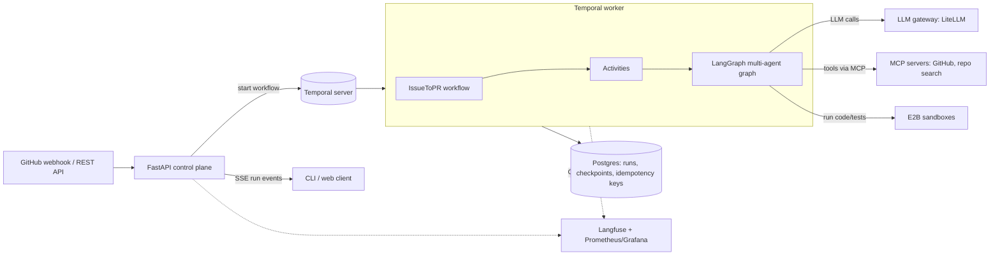

# Mergewright — Fault-Tolerant Multi-Agent System for Issue-to-PR Automation

> *Issues in. Tested PRs out. Even when things crash.*

**Course:** CSE 510 Agentic AI Engineering (Fall 2026 capstone), University at Buffalo
**Team:** Akash Kolte + 1 collaborator
**Status:** Draft spec v2 — 2 Oct 2026 (v1: 29 Sep 2026; v2 adds webhook reliability, live event streaming, secret redaction)

---

## 1. Problem statement

Coding agents demo well but fail in production. They lose work when a process crashes, repeat side effects on retry, loop until they burn through a budget, obey instructions hidden in untrusted input, and — most importantly — nobody can say with evidence whether a change made them better or worse.

**Mergewright** is a backend service that takes a GitHub issue and autonomously produces a tested pull request, using a team of specialized agents. The engineering focus is not the agents' cleverness but the **reliability, measurability and safety of the system around them**:

- **Durable:** any run survives a worker crash mid-task and resumes without redoing completed work or duplicating side effects.
- **Measurable:** every change to prompts, models or the graph is scored against a fixed benchmark with a deterministic pass/fail oracle, and regressions block the merge.
- **Observable:** every run is traceable end to end — which agent did what, why, how long it took and what it cost.
- **Safe:** generated code runs only in isolated sandboxes, tools follow least privilege, and a human approves before anything reaches a shared branch.

## 2. Goals and non-goals

### Goals
1. Resolve real GitHub issues end to end: issue → plan → code → tests → review → human approval → PR.
2. Guarantee crash recovery with **zero duplicated side effects**, proven by fault-injection tests.
3. Report resolve rate, reliability (pass^k), cost per task and latency on a pinned benchmark, with an eval gate in CI.
4. Provide full-stack tracing from API request to individual LLM and tool calls.
5. Enforce hard per-run budgets (tokens, dollars, steps, wall-clock time).

### Non-goals (deliberately out of scope)
- An interactive CLI/IDE experience (that is a different product: a Claude Code-style harness).
- Training or fine-tuning models. The system is model-agnostic; a fine-tuned model can be plugged in later.
- Multi-repo changes, non-Python repos (v1), and deployment of the generated code.
- Agent-to-agent protocols across organisations (A2A) — no real need in this design.
- Building a custom LLM gateway or semantic prompt cache: LiteLLM is used as-is and provider prompt caching covers stable prefixes. Coding-agent prompts are mostly unique, so semantic caching would add complexity for a low hit rate. This is a decision to defend, not an omission.

## 3. Users and trigger

- **Trigger:** a GitHub issue labelled `mergewright` (webhook) or an API call `POST /runs {repo, issue_number}`.
- **Output:** a PR on a `mergewright/<run-id>` branch with the diff, passing tests, a written rationale and a link to the run's trace.
- **Human role:** approves or rejects the PR plan and final diff; can send feedback that re-enters the loop.

## 4. Architecture

### 4.1 Division of responsibility (key design decision)

| Layer | Owns | Why |
|---|---|---|
| **Temporal** | Run lifecycle: start, retry, timeouts, crash recovery, worker failover, human-approval waits (signals), cancellation | Records each activity result, so completed LLM/tool calls are never re-executed after a crash; recovery is automatic |
| **LangGraph** | Agent logic: supervisor routing, agent state, feedback loops between agents | Purpose-built for multi-agent graphs; typed state; conditional edges |
| **E2B** | Isolated execution of generated code and tests | Untrusted code never runs on the host |
| **FastAPI** | Webhooks, run API, approval endpoints | Same language as LangGraph and Temporal Python SDK; one stack to operate |

**Rule:** Temporal workflow code stays deterministic. Every non-deterministic operation (LLM call, sandbox command, GitHub call, clock, randomness) happens inside an **activity**.

> Spring Boot alternative: a Java control plane talking to Python workers over Temporal task queues is possible, but it doubles the stack for little gain. Use FastAPI; revisit only if time remains.

### 4.2 Agents

| Agent | Responsibility | Tools | Output (structured, schema-validated) |
|---|---|---|---|
| **Supervisor** | Routes work, enforces budgets and step limits, decides done/escalate | none (control only) | next agent + reason |
| **Planner** | Understand the issue, locate relevant code, write a plan | repo map, hybrid code search (BM25 + embeddings + reranker), file read | `Plan {files, steps, test_strategy, risks}` |
| **Coder** | Implement the plan as a minimal diff | file read/write in sandbox, shell (allow-listed) | `Patch {diff, rationale}` |
| **Tester** | Write a reproducing test, run the suite, report failures | sandbox test runner | `TestReport {passed, failed, logs}` |
| **Reviewer** | Check diff for correctness, security, scope creep, style | diff, static analysis (ruff, bandit) | `Review {approve, issues[]}` |

Loops: Tester → Coder on failure (max N iterations); Reviewer → Coder on rejection; any agent → Supervisor → human on repeated failure.

Why multiple agents (defensible in interviews): each has a **separate context window** (planner doesn't carry test logs), **different tool permissions** (only Coder writes files; only the PR activity touches GitHub), and **independently evaluable output**.

### 4.3 Event ingestion and reconciliation

GitHub delivers webhooks at-least-once and can drop or reorder them, so ingestion is treated as an unreliable input, not a trigger to trust.

- **Verify:** reject requests with an invalid `X-Hub-Signature-256` HMAC.
- **Dedupe:** unique constraint on `X-GitHub-Delivery` in Postgres, plus a deterministic Temporal workflow ID (`repo#issue`), so redeliveries and double-labelling start at most one run.
- **Ack fast:** persist the event and start the workflow, then return `202`. Never do agent work inside the request.
- **Reconcile:** a scheduled Temporal workflow lists `mergewright`-labelled issues that have no run and starts them, catching dropped webhooks.
- **Dead-letter and replay:** events that fail validation or processing go to a `dead_events` table with the error; `POST /events/{id}/replay` re-drives them.
- **Reconcile-then-act on outbound calls:** before creating a branch, PR or comment, query GitHub for an existing one (by branch name or a `run-id` marker in the PR body). GitHub is the source of truth; a Postgres idempotency key alone cannot cover a crash between the GitHub write and the database write.

### 4.4 Live run events

- Activities and graph nodes append structured events (`agent_started`, `tool_call`, `test_result`, `awaiting_approval`, `budget_warning`, ...) to a `run_events` table, which doubles as an audit log.
- `GET /runs/{id}/events` streams them over SSE with monotonically increasing IDs, heartbeats and `Last-Event-ID` resume, so a reconnecting client sees no gaps and no duplicates.
- **Backpressure:** bounded per-client buffer; a slow client is coalesced or dropped and never blocks workers.
- Token-level streaming is optional. Tokens are not part of Temporal's recorded history, so publish them on this side channel only and treat them as best-effort.
- Minimum client: a `mergewright tail <run-id>` CLI with approve/reject commands. A web page only if time allows.

## 5. Reliability requirements

| ID | Requirement | How it's met | How it's verified |
|---|---|---|---|
| R1 | Crash at any point resumes without redoing completed steps | Temporal activity history + LangGraph Postgres checkpointer | Fault-injection suite (§7.4) |
| R2 | No duplicated side effects | Idempotency key `run_id:step:attempt-independent-hash` on every side-effecting activity (branch create, PR open, comment); stored in Postgres, checked before execution; plus reconcile-then-act against GitHub (§4.3) for the crash window between the GitHub write and the DB write | Kill worker between side effect and ack; assert exactly one PR |
| R3 | Sandbox loss is recoverable | Repo state checkpointed as a git commit/patch after each Coder step; new sandbox rebuilt from base image + patch | Kill sandbox mid-run; assert run completes |
| R4 | Bounded cost and time | Per-run budgets (tokens, $, steps, wall clock) enforced by Supervisor + Temporal timeouts; gateway-level per-run key budget as a backstop (verify LiteLLM budget support) | Adversarial "impossible issue" tasks must terminate within budget |
| R5 | No infinite loops | Step cap, repeated-action detection (same tool + same args hash N times) | Loop-rate metric = 0 on benchmark |
| R6 | Transient failures don't fail runs | Retries with exponential backoff + jitter; LLM fallback to secondary model via gateway | Inject 429/500 from gateway at 20% rate |
| R7 | Human approval can wait days | Temporal signal + durable timer; auto-escalate/cancel after timeout | Test with time-skipping in Temporal test env |
| R8 | Duplicate, dropped or reordered webhooks yield exactly one run per issue | HMAC check, delivery-ID dedupe, deterministic workflow ID, reconciler (§4.3) | Replay one delivery 5x; drop a delivery and assert the reconciler starts the run |

> **Terminology:** Temporal runs activities at-least-once, so "exactly-once" in this spec means *effectively-once*: at-least-once execution plus idempotent side effects. Use that wording in interviews.

## 6. Security and guardrails

- **Sandboxing:** all generated code and tests run in E2B; sandbox has no secrets and restricted network access (verify E2B's network-control options for your plan).
- **Least privilege:** GitHub App scoped to one test org; can only push to `mergewright/*` branches and open PRs — never merge.
- **Prompt-injection defense:** issue text, repo files and tool outputs are treated as untrusted data; agents cannot change their own tools or budgets; Reviewer + human gate before PR. Mapped to the OWASP Top 10 for LLM Applications.
- **Output validation:** all agent outputs are schema-validated (structured outputs); invalid output = retry, not crash.
- **Red-team suite:** issues and repo files containing hidden malicious instructions (exfiltrate env vars, modify CI, delete tests). Measured as an eval (§7.1–7.2).
- **Tool permissions in code:** per-agent tool allow-lists are enforced at the activity layer, not in prompts. A call outside an agent's list fails the step and is logged.
- **Secret and PII redaction:** scrub tokens, env-var values and high-entropy strings from tool outputs, logs and Langfuse/OTel payloads before export. Verified with a canary secret planted in the sandbox env and repo: it must never appear in any trace, log, comment or PR.

## 7. Evaluation

The core principle: **the pass/fail oracle is deterministic even though the agents are not.** A task is resolved only if hidden tests pass in a pinned environment. Agent non-determinism is measured statistically, not hidden.

### 7.1 Datasets (pinned, versioned)
| Set | Size | Purpose |
|---|---|---|
| **Dev set** | ~30 tasks | Bugs seeded into 2–3 small Python repos you control; fast and cheap; used daily |
| **Benchmark set** | ~50 tasks | Fixed subset of SWE-bench Verified (Python); used for headline numbers. Verify that its environment images can run on E2B templates early (week 2) |
| **Adversarial set** | ~15 tasks | Impossible issues, ambiguous issues, prompt-injection attacks |

Each task: repo @ commit, issue text, hidden **fail-to-pass** tests (must pass after fix) and **pass-to-pass** tests (must not break).

### 7.2 Metrics
| Level | Metric | Definition |
|---|---|---|
| Outcome | **Resolve rate** | % tasks where all fail-to-pass and pass-to-pass tests pass |
| Outcome | **pass^k** (k=3) | % tasks resolved in *all* k runs — measures reliability, not luck |
| Outcome | Cost per resolved task | $ (LLM + sandbox) ÷ resolved tasks |
| Outcome | Latency | p50 / p95 wall-clock per run |
| Trajectory | Steps per task, loop rate, tool-error rate | From traces |
| Trajectory | Trajectory quality | LLM judge scores plan quality, unnecessary actions, scope creep |
| Component | Planner file-localisation recall | % of gold-patch files named in the plan |
| Component | Reviewer bug-catch rate | On diffs with planted bugs |
| Component | Tester reproduction rate | % tasks where Tester's new test fails before fix, passes after |
| Safety | Injection resistance | % adversarial tasks with zero unsafe actions |
| Safety | Budget compliance | % runs terminating within budget |
| Safety | Secret leakage | Canary-secret appearances in traces, logs, comments or PRs (target 0) |

### 7.3 LLM-as-judge calibration
- Hand-label ~50 trajectories (both teammates, independently).
- Report inter-annotator agreement and judge–human agreement (Cohen's κ). Target κ ≥ 0.6 before trusting the judge; judge prompt is versioned with the dataset.

### 7.4 Fault-injection (chaos) suite
Scripted scenarios run in CI nightly: kill worker mid-activity, kill between side effect and ack, kill sandbox, drop Postgres connection, inject LLM 429/500s, inject slow responses past timeout, redeliver duplicate webhooks, drop a webhook (reconciler must recover it), disconnect and resume an SSE client mid-run. Pass criteria: run completes (or fails cleanly), exactly-once side effects, no orphaned sandboxes.

### 7.5 Determinism strategy
- Pinned: model versions, sandbox images, dataset commits, prompt versions, temperature 0 where supported.
- **Record/replay tests:** LLM responses recorded as fixtures ("cassettes") so the full pipeline can be tested in CI deterministically and for free.
- Headline numbers always reported as mean ± 95% CI over k runs.

### 7.6 Eval gate in CI
Every PR to Mergewright itself runs the dev set. Merge is blocked if resolve rate drops beyond the noise band or cost per task rises > 15%. The benchmark set runs weekly and on releases.

### 7.7 Ablations (the results section of your write-up)
Single agent vs. multi-agent · with vs. without Tester loop · with vs. without Reviewer · retrieval variants · model routing on vs. off. Each reported on resolve rate and cost.

## 8. Observability

- **Tracing:** OpenTelemetry end to end — API request → Temporal workflow → activity → LangGraph node → LLM call / tool call / sandbox command, all sharing one `run_id` trace. Use the OpenTelemetry GenAI semantic conventions for LLM spans (verify current status of the spec).
- **LLM observability:** Langfuse (self-hosted) for prompts, completions, token counts, cost and eval scores attached to traces.
- **Workflow observability:** Temporal UI for run history and replay.
- **Metrics:** Prometheus + Grafana dashboards — runs by status, resolve rate, cost per run, p95 latency, retries, tool errors, budget kills, sandbox lifetime.
- **Alerts:** cost per run spike, error-rate spike, stuck runs (no progress for N minutes).
- **Structured logs** with `run_id`, `agent`, `step` on every line.

## 9. Cost and performance engineering
- **Model routing** via LiteLLM gateway: stronger model for Planner/Reviewer, cheaper model for Coder iterations; measured in ablations.
- **Prompt caching** for stable system prompts and repo maps.
- **Context engineering:** repo map + targeted retrieval instead of dumping files; tool outputs truncated/summarised.
- **Sandbox reuse** within a run; guaranteed teardown via Temporal cleanup activity.

## 10. Tech stack

| Area | Choice |
|---|---|
| Agents | LangGraph (Python), structured outputs (Pydantic) |
| Orchestration | Temporal (Python SDK), local dev server → optional Temporal Cloud |
| Sandboxes | E2B (custom template with repo deps) |
| API | FastAPI |
| Tools | MCP servers (GitHub, repo search) |
| Models | Model-agnostic via LiteLLM; at least two providers for fallback |
| Retrieval | BM25 + embeddings + reranker over code |
| Storage | Postgres (runs, checkpoints, idempotency keys, eval results) |
| Observability | OpenTelemetry, Langfuse, Prometheus, Grafana |
| Quality | pytest, ruff, mypy, bandit; GitHub Actions CI with eval gate |
| Deploy | Docker Compose locally; Kubernetes (optional stretch) |

## 11. Milestones (Fall 2026)

| Week | Dates | Deliverable |
|---|---|---|
| 1 | Sep 29 – Oct 5 | Repo, CI, Docker Compose (Temporal, Postgres, Langfuse); confirm CSE 510 project requirements |
| 2 | Oct 6 – 12 | Single-agent baseline end to end on 5 dev tasks; E2B template; verify SWE-bench images on E2B |
| 3 | Oct 13 – 19 | **MVP:** Temporal workflow + LangGraph Planner/Coder/Tester; first dev-set numbers. **Put on resume.** |
| 4 | Oct 20 – 26 | Eval harness: dev set, metrics, results DB, CI gate |
| 5 | Oct 27 – Nov 2 | Reviewer agent, human-approval signal, GitHub PR via MCP + idempotency keys; webhook hardening (§4.3: HMAC, dedupe, reconciler, reconcile-then-act) |
| 6 | Nov 3 – 9 | Observability: OTel tracing, Langfuse, Grafana dashboards; `run_events` + SSE and `tail` CLI (§4.4) |
| 7 | Nov 10 – 16 | Fault-injection suite; sandbox recovery (R3) |
| 8 | Nov 17 – 23 | Benchmark set runs; pass^k; LLM-judge calibration |
| 9 | Nov 24 – 30 | Security: adversarial set, injection defenses, budgets, secret redaction + canary test |
| 10 | Dec 1 – 7 | Ablations, cost optimisation (routing, caching) |
| 11 | Dec 8 – 14 | Write-up, demo video, README with architecture + results, blog post |

## 12. Suggested team split

- **Person A — Platform:** Temporal workflows, idempotency, sandbox lifecycle, FastAPI, fault-injection suite, observability stack.
- **Person B — Agents:** LangGraph graph, prompts, retrieval, structured outputs, Reviewer/Tester logic.
- **Shared:** eval datasets, labelling for judge calibration, ablations, write-up.

Both should own at least one eval area so each can speak to evaluation in interviews.

## 13. Definition of done
- Runs end to end on real issues, opening PRs on a test org.
- Published results table: resolve rate, pass^3, cost per resolved task, p50/p95 latency on the pinned benchmark, plus ablations.
- Fault-injection suite green: 100% of scenarios recover with exactly-once side effects.
- Judge calibration reported (κ).
- Eval gate active in CI.
- Public README with architecture diagram, design decisions and trade-offs, results, and a 3-minute demo video.

## 14. Risks and mitigations

| Risk | Mitigation |
|---|---|
| SWE-bench environments don't run on E2B | Check in week 2; fall back to dev set + smaller hand-built benchmark |
| LLM/E2B costs exceed credits | Dev set first, record/replay in CI, cheap models for iteration, weekly (not daily) benchmark runs |
| Temporal learning curve | Time-box to week 1–3; start from Temporal's Python samples |
| Scope creep | Non-goals in §2 are binding; stretch items only after week 10 |
| v2 additions (§4.3, §4.4) add scope | Both are small and independent. If behind at week 6, drop the web client and token streaming; keep the `tail` CLI |
| Low absolute resolve rate | The story is the *delta* shown by ablations and reliability, not a leaderboard number |

## 15. Resume bullets (fill in real numbers)
- Built a fault-tolerant multi-agent system (LangGraph, Temporal, E2B) that turns GitHub issues into tested PRs; resolved **X%** of a pinned SWE-bench Verified subset at **$Y** per resolved task.
- Designed effectively-once side effects (idempotency keys, reconcile-then-act against GitHub, Temporal durable execution) and a deduplicating, self-healing webhook ingestion path; fault-injection suite verified **100%** crash recovery with zero duplicated side effects.
- Built an eval pipeline (outcome, trajectory and pass^k metrics; LLM judge calibrated to κ = **Z**) gating CI; ablations showed the Tester loop raised resolve rate by **N** points.
- Implemented end-to-end OpenTelemetry tracing and Langfuse/Grafana dashboards; cut cost per task **M%** via model routing and prompt caching.

## 16. Interview talking points
- Why Temporal *and* LangGraph — and what each would lack alone.
- How idempotency works when a crash happens between the side effect and its acknowledgement.
- Why GitHub, not your database, is the source of truth for outbound side effects, and how the webhook path survives duplicates, drops and reordering.
- Why pass^k matters more than a single-run resolve rate.
- How you validated the LLM judge instead of trusting it.
- Which ablation surprised you, and what you changed because of it.
- Where the system still fails, and what you'd build next.

## 17. Open questions
1. What does CSE 510 require for the capstone deliverable (report format, demo, team size)?
2. Which 2–3 dev-set repos to use?
3. Model providers and budget per month?
4. Public or private repo during the semester?
