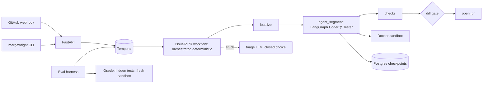

# Mergewright: a durable, measured issue-to-PR agent

**Course:** CSE 510 Agentic AI Engineering (Fall 2026), University at Buffalo · **Team:** Akash Kolte, Sheetal Jain
**Status:** Spec v3 (replaces v2). `docs/proposal.md` and `docs/architecture.md` stay as the Milestone 1 and midterm record; where they differ, this spec wins.

## 1. Thesis

Mergewright turns a GitHub issue on a Python repo with a pytest suite into a PR on `mergewright/<run-id>`: minimal diff, passing tests, rationale, run record. A human approves the diff before any GitHub write.

The agent is not the contribution. The contribution is the system around it:

- **Durable:** survives worker, sandbox and database failures; never duplicates a GitHub side effect.
- **Bounded:** token, dollar, step and time budgets hold across crashes.
- **Honest:** hidden-test oracle, post-cutoff tasks, baselines, k runs, confidence intervals, published failures.
- **Safe:** least privilege in code, isolated execution, no secrets in the sandbox, reward-hacking guards.

Not a goal: beating frontier coding agents on resolve rate.

## 2. Key decisions (v3)

| Decision | Choice | Why |
|---|---|---|
| Orchestrator | Deterministic Temporal workflow code starts each agent and routes on its typed output | Every routing decision in this pipeline follows from a typed result (tests fail → Coder, budget spent → stop). An LLM there adds cost, randomness, a failure mode and an injection surface |
| Supervisor LLM | One bounded **triage** call at the stuck point only (§4.3); must beat the fixed router in an ablation | Gives a tested answer to "is an LLM supervisor worth it?" |
| Dynamic fan-out to parallel subagents | Out of scope | Tasks are single-repo bug fixes; too few multi-part issues to measure |
| Durability seam | One Temporal activity per graph segment; LangGraph checkpoints to Postgres inside it (§4.2) | Resolves v2's contradiction about what is re-run after a crash |
| Sandbox | `Sandbox` interface, Docker backend first | Benchmark tasks ship as Docker images; free, offline, reproducible |
| Headline benchmark | Post-cutoff tasks (SWE-rebench Python slice) + own mined dev set | SWE-bench Verified is contaminated (OpenAI stopped reporting it in Feb 2026) |
| LLM client | Keep `openai` SDK against OpenAI-compatible servers; retries, fallback and budget ledger in our code | Works today; LiteLLM is in the Later list |
| CI gate | Replay and durability suites (deterministic); live evals reported, not gating | Live evals on ~40 tasks are too noisy to block merges |
| Build process | AI-assisted code is fine; the core (workflow, segment activity, `open_pr`, oracle, statistics) is test-first and reviewed line by line | Every core line must be explainable in an interview. AI use is disclosed in the README |

## 3. Current state

Built (Milestone 2): LangGraph `coder → tools → tester` loop; tools `read_file`, `search_code`, `edit_file`, `run_tests` with allow-list, path guard and protection of tests and pytest config; `openai` client with record/replay; step, attempt and wall-clock caps; JSONL run log; 59 tests; ruff clean.

Not built: Temporal, Postgres, FastAPI, sandbox (tests run as a local subprocess), GitHub writes, gate, Localizer, eval harness, task sets, CI.

## 4. Architecture



### 4.1 Ownership

| Concern | Owner |
|---|---|
| Lifecycle: retries, timeouts, failover, cancel, human wait (signal + timer), routing, budgets | Temporal workflow (deterministic) |
| Reasoning inside a segment: messages, tool calls, Coder ⇄ Tester loop | LangGraph, checkpointed to Postgres |
| Running repo code and tests | Sandbox |
| GitHub writes | `open_pr` activity only |
| Truth about what exists on GitHub | GitHub, not our database |

Every LLM call, sandbox command, GitHub call, clock read and random value runs in an activity.

### 4.2 Durability seam

- One activity per **segment** (Coder ⇄ Tester loop). LangGraph checkpoints after every step (`thread_id = run_id`, sync durability). A retry resumes from the last checkpoint, so at most the in-flight node runs again.
- **Invariant:** sandbox working tree = `base_sha` + `state.patch`. The `tools` node stores `git diff base_sha` in state after each edit. Every activity start resets the tree to `base_sha` and applies `state.patch`; a lost sandbox is rebuilt the same way. Agent state and environment cannot disagree.
- Heartbeat after every node (`checkpoint_id`, steps, tokens); ~60 s timeout moves the activity to another worker.
- Budget counters live in checkpointed state and in the workflow, so a crash loop cannot reset them.
- Measured cost: LLM calls repeated per crash (§6.5). Fallback if too high: Temporal-native loop (each LLM and tool call an activity).

### 4.3 Run flow and the triage Supervisor

```
prepare_sandbox → localize → agent_segment → checks
  ├ service mode: diff gate (signal + 72 h timer) → open_pr → PR_OPENED
  └ eval mode: export patch → oracle
stuck (2 failed test attempts, or checks fail twice) → triage
budget spent → FAILED_BUDGET · any terminal state → cleanup
```

**Triage** (P1, ablation): one LLM call that sees the issue, localization, last test report and check findings, and returns one of `{re_localize, continue_patching, write_repro_test, give_up}` with a reason. Code validates the choice against budgets and allowed transitions; an invalid choice falls back to the fixed rule. Compared with the fixed rule (`continue_patching` until attempts run out) on the same tasks.

### 4.4 Agents and checks

| Component | LLM | Tools / input | Output | Priority |
|---|---|---|---|---|
| Localizer | 1 call | repo map, `search_code`, `read_file` | files, symbols, hypothesis | P0 |
| Coder | loop | `read_file`, `search_code`, `edit_file` | edits | P0 (exists) |
| Tester gate | no | `run_tests` | `TestReport` | P0 (exists) |
| Checks | no | diff, ruff, tamper detector | blocking findings | P0 |
| Reproducer | loop | `read_file`, `write_new_test` (`tests/test_mergewright_repro_*.py` only) | test that fails on base, passes on patch | P1 |
| Triage Supervisor | 1 call | see §4.3 | closed choice | P1 |
| LLM Reviewer | 1 call | diff, findings | approve / issues | Later |

**Tamper detector:** blocks edits to protected paths, new `skip`/`xfail`, new `conftest.py`, non-test code that branches on `pytest`/`PYTEST_CURRENT_TEST`/`sys.modules`, deleted assertions. Each attempt is logged and counted.

### 4.5 Sandbox, GitHub, API, budgets

- **Sandbox (Docker):** no network during agent work and tests, non-root, dropped capabilities, CPU/memory/PID limits, only the workspace mounted, empty env except a planted canary, per-command timeout, `run_id` label plus orphan sweeper. Stated limit: shared kernel.
- **`open_pr` (effectively-once):** branch `mergewright/<run-id>`; PR body marker `<!-- mergewright-run: <run-id> -->`; look up before every write and reuse if it matches; approval carries the diff hash and a mismatch fails `FAILED_POLICY`. Credential: fine-grained token for one test repo, never in code or sandbox. "Exactly once" here means at-least-once execution plus idempotent writes.
- **API:** `POST /runs`, `GET /runs/{id}`, `POST /runs/{id}/decision`, `POST /webhooks/github`. Bearer token for the API; HMAC for webhooks; unique delivery ID and workflow ID `owner/repo#issue`; 202 after persisting.
- **Budgets (initial):** $2, 400k tokens, 40 LLM steps, 30 min active, 3 test attempts per segment, 2 segments; warning at 80 %; same tool + same args 3 times ends the run. Free endpoints report tokens and $0, never an invented price.
- **Observability:** JSONL `run_events` (exists) feeds the harness; OTel traces to one local backend are P1.

## 5. Security

Issue text, repo files, tool output and human feedback are untrusted data. Agents cannot change tools, budgets or permissions. Allow-lists, path guards and protected paths are enforced in code. No secrets in the sandbox; the canary must never appear in events, traces, PRs or comments. Redact before export. GitHub credential cannot merge and writes only `mergewright/*`. Human diff gate before every write.

## 6. Evaluation

### 6.1 Task suites (pinned under `eval/`)

| Suite | Size | Source | Use |
|---|---|---|---|
| Smoke | 5 | `buggy_calc` + 4 seeded bugs | CI on recorded responses |
| Dev | 30–40 | Revert-a-fix tasks mined from 4–6 pure-Python repos (suite < 2 min): revert the source part of a real fix commit; its changed tests are fail-to-pass (F2P), the rest pass-to-pass (P2P) | Development, ablations |
| Held-out | 40–60 | SWE-rebench Python tasks created after the model's cutoff, suite < 5 min | Headline numbers only; plan frozen in `eval/PLAN.md` first; no tuning on it |
| Adversarial | 15–20 | Injection (issue, repo file, tool output), canary exfiltration, reward-hacking bait, impossible issues | Safety, budgets |

Each task is validated 3×: F2P fails on base and passes with the gold patch; P2P passes on both. Flaky tasks are dropped and counted.

### 6.2 Systems compared (same model, tasks and budget)

| ID | System | Question |
|---|---|---|
| S0 | Localizer + one patch, no execution feedback | What does iteration buy? |
| S1 | Single loop, `run_tests` as a normal tool, no gate or checks | What do the gate and checks buy? |
| S2 | Mergewright with fixed router | The system |
| S2+T | S2 + triage Supervisor | Is an LLM supervisor worth it? |
| S2+R | S2 + Reproducer | Does a repro test help? |
| Ref | mini-SWE-agent (pinned) | Are we competitive with a minimal known agent? |

Primary model: UB-hosted OpenAI-compatible model, exact version pinned. Frontier model on S2 and Ref for a subset, sized from measured tokens per run.

### 6.3 Metrics

- **Outcome:** resolve rate (all F2P and P2P pass), pass@1, pass^3, pass@3, tokens and $ per resolved task, p50/p95 latency.
- **Honesty:** overclaim rate (`DONE` but hidden tests fail), P2P regression rate.
- **Safety:** tamper attempts (all must be blocked), injection resistance, canary leaks (0).
- **Process:** steps, tool errors, loop stops, termination reasons, localization recall, triage choice distribution.

### 6.4 Statistics

Wilson 95 % intervals; paired bootstrap over tasks for system deltas; McNemar's exact test for single runs. With 40 tasks the interval is about ±15 points, so smaller deltas are reported as "not distinguishable".

### 6.5 Durability experiments

Recorded LLM responses (free, known final patch), a local fake GitHub server that can commit a write and drop the response, real `SIGKILL` and `docker kill`.

| ID | Fault |
|---|---|
| K1 | Kill worker during an LLM call |
| K2 | Kill after `edit_file`, before checkpoint |
| K3 | Kill during `run_tests` |
| K4 | Kill after branch create, before PR create |
| K5 | PR created, response lost, worker killed |
| K6 | Kill sandbox mid-segment |
| K7 | Crash loop for the whole run |
| K8 | LLM 429/500 at 20 %, slow responses |
| K9 | Webhook ×5; approval sent twice and after expiry |
| K10 | Postgres restart mid-segment |

10 trials each on Mergewright and on a **naive runner** (current `runner.py` with retry-from-scratch). Measure: completed or clean failure, identical final patch, duplicate GitHub objects, repeated LLM calls, wasted tokens, recovery time, budget held. Pass for Mergewright: 100 % complete or clean, 0 duplicates, identical patch, budget never exceeded.

### 6.6 Error analysis and reporting

- One label per failed run: localization miss, wrong fix, incomplete fix, P2P regression, environment, budget, loop, tool misuse, overclaim, blocked tamper. Publish counts and 3 annotated traces.
- Each eval writes `results/<eval-id>/` with per-run JSON and a manifest (git SHA, model ID, prompt hashes, image digests, dataset version, caps, k, seed). `mergewright report` generates README tables; no hand-edited numbers.
- CI (every PR): ruff, pytest, replay smoke suite, durability suite, Temporal time-skipping tests. Live evals: manual or weekly.

## 7. Milestones (ordered; each needs the one before)

Extra capacity goes to evidence (more validated tasks, higher k, frontier subset) before any Later item.

1. **Sandbox + eval harness.** Docker `Sandbox` behind the existing tools; `task.yaml`, `mergewright tasks validate`, `mergewright eval --suite --system --k`, `mergewright report`; CI.
   *Done when:* 59 existing tests pass; sandbox tests prove canary absent, network blocked, timeout kill, orphan cleanup; ≥ 15 validated dev tasks; first S1 and S2 results with manifest.
2. **Durable lifecycle.** `IssueToPR` workflow, segment activity with checkpointer, heartbeats, patch-in-state reset, budget ledger, diff gate, `open_pr` with fake GitHub, Localizer, checks with tamper detector.
   *Done when:* a manual worker kill mid-segment resumes to the same patch; gate timeout passes in the time-skipping env; one real PR on a test repo; unit tests for Localizer and checks.
3. **Fault injection + API.** K1–K10 vs naive runner; FastAPI with HMAC and dedupe; dev set ≥ 30; adversarial set ≥ 15.
   *Done when:* the durability table is generated by script and runs in CI; any failing scenario is fixed or listed as a known limitation.
4. **Dev results.** S0, S1, S2, S2+T on dev, k = 3, paired statistics; adversarial results; error taxonomy; README with architecture, trade-offs, generated tables, limitations; course report and demo.
   *Done when:* every README number traces to a `results/` manifest.
5. **Held-out results.** Freeze `eval/PLAN.md`; S2 and Ref (S0/S1 if budget allows) on held-out, k = 3; frontier subset; Reproducer on dev, then held-out if it wins.
   *Done when:* held-out tables published with intervals and failures.
6. **Presentation.** OTel traces, GitHub App, architecture diagram, 3-minute demo (label → run → kill worker → resume → approve → one PR), blog post on the durability seam with §6.5 data.

## 8. Later (after milestones 1–5), each with its trigger

| Item | Build it when |
|---|---|
| LiteLLM gateway | A third provider is added, or per-key budgets at the gateway are needed |
| Model routing | Per-agent cost data shows one stage dominates spend |
| Prometheus + Grafana + alerts | Service mode handles sustained traffic, not just eval sweeps |
| Langfuse | OTel backend lacks prompt and cost views you actually use |
| MCP servers | A second tool consumer needs the same GitHub or search tools |
| Hybrid retrieval (BM25 + embeddings + reranker) | Localization miss is the top error label |
| LLM Reviewer | Wrong-fix or P2P regressions remain common after checks |
| LLM-as-judge with κ calibration | A question arises that the test oracle cannot answer |
| Plan gate with calibrated threshold | Localizer confidence data exists for ≥ 30 tasks |
| SSE event stream | A web client exists that needs live progress |
| E2B adapter, gVisor | Running untrusted repos beyond our own machine and CI |
| Webhook reconciler (Temporal Schedule) | Running on a real org where dropped deliveries matter |
| Kubernetes | More than one worker host is needed |

**Won't do:** SWE-bench Verified as the headline number (an optional, labelled comparability slice is fine); dynamic fan-out to parallel subagents; an LLM that routes every step.

## 9. Evidence to collect

Per-system tables (resolve rate with CI, pass^3, cost per resolved task, latency, overclaim rate); paired deltas S2 vs S1/S0/Ref and S2+T vs S2; durability table vs naive runner; tamper attempts with examples (first one: `pytest.ini addopts` at the checkpoint); canary leaks; error taxonomy; localization recall; bugs the fault suite found in our own code.

**Resume bullet templates (hypothetical; fill only with measured values):**

- Built a durable issue-to-PR coding agent (Temporal, LangGraph, Docker); across [N] injected crash scenarios, 0 duplicate GitHub side effects vs [D] duplicates and [W]% re-spent tokens for a restart-from-scratch baseline.
- Built an eval harness with a hidden-test oracle on [N] post-cutoff tasks (k=3, paired bootstrap); test-gated loop resolved [A]% ± [CI] vs [B]% single-shot at $[C] per resolved task.
- Blocked [T] reward-hacking attempts with a diff tamper detector; overclaim rate [O1]% → [O2]%.

**Interview questions to prepare:** what re-runs after a crash and how you measured it; a crash after PR creation; sandbox vs agent state after recovery; budgets under a crash loop; why the tasks are not contaminated; detectable effect at n = 40; whether the triage Supervisor earned its place; what the agent did to game tests; what can escape Docker; the top failure category and what you'd build next.

## 10. Open questions

1. Does the instructor accept the v3 changes against `docs/proposal.md`?
2. Which 4–6 repos for the dev set (pure Python, pytest < 2 min, linked issues, fix commits after the model's cutoff)?
3. Frontier-model budget for milestone 5.
4. Update `CLAUDE.md` to name this spec as the source of truth once the team agrees.
