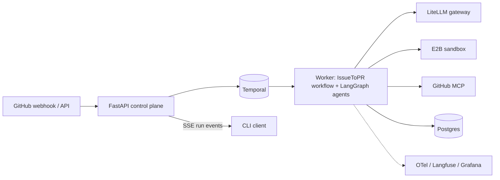

# Mergewright: A Fault-Tolerant Multi-Agent System for Issue-to-PR Automation

**Course:** CSE 510 Agentic AI Engineering, Fall 2026 · **Milestone 1:** Project Proposal
**Team:** Akash Kolte + 1 collaborator (see §7)

> **Scope note.** This proposal is our current plan, not a contract. Scope, numeric targets and design details may change as we start building and measuring. Material changes will be recorded in the repo. If we must cut, we cut in this order: streaming extras, ablation breadth, security suite breadth. The durable pipeline, the eval harness and fault-injection testing are the core and stay.

---

## 1. Problem statement

**Users.** Maintainers and small engineering teams who own Python repositories with a pytest suite and a backlog of small, well-described bug reports.

**Task.** Given a GitHub issue labelled `mergewright` (via webhook or `POST /runs {repo, issue_number}`), autonomously produce a pull request on a `mergewright/<run-id>` branch containing a minimal diff, a reproducing test, passing test results, a written rationale and a link to the run's trace. A human maintainer approves the plan and the final diff before the PR is opened.

**What we are really solving.** Coding agents demo well but fail in production: they lose work when a process crashes, repeat side effects on retry, loop until the budget is gone, obey instructions hidden in untrusted issue text or repo files, and nobody can show with evidence whether a change made them better or worse. Mergewright's contribution is the **reliability, measurability, observability and safety of the system around the agents**, not agent cleverness:

- **Durable:** a run survives a worker crash and resumes without redoing completed work or duplicating side effects.
- **Measurable:** every change to prompts, models or the graph is scored on a fixed benchmark with a deterministic pass/fail oracle; regressions block the merge.
- **Observable:** every run is traceable from API request to individual LLM and tool calls, with cost and latency.
- **Safe:** generated code runs only in isolated sandboxes, tools follow least privilege, and a human approves before anything reaches GitHub.

## 2. Why an agent

Resolving an issue is open-ended and the path is not known in advance. The system has to localize the relevant code, form a plan, edit, run tests, read failures, and adjust, and the number of iterations and the tools needed depend on what each observation returns. A fixed prompt or a hard-coded pipeline cannot branch on that feedback. This is a loop of observe, decide, act with tools and environment feedback, which is what an agent is.

We use **multiple agents** for engineering reasons we can test, not for fashion:

- **Separate context windows:** the Planner does not carry the Tester's logs.
- **Different tool permissions:** only the Coder writes files; only a guarded activity touches GitHub.
- **Independently evaluable outputs:** each agent returns a schema-validated structure we can score on its own.

We treat "multi-agent beats single-agent" as a hypothesis, and test it with ablations (§5) rather than assuming it.

**Architecture in one view.**

| Layer | Owns |
|---|---|
| **Temporal** | Run lifecycle: retries, timeouts, crash recovery, human-approval waits (signals and durable timers), cancellation. Workflow code stays deterministic; every LLM, sandbox and GitHub call is an activity. |
| **LangGraph** | Agent logic: Supervisor routing, typed agent state, Tester→Coder and Reviewer→Coder feedback loops. |
| **E2B** | Isolated execution of generated code and tests. |
| **FastAPI + Postgres** | Webhooks, run and approval APIs, SSE event stream; runs, checkpoints, idempotency keys, eval results. |

Agents: **Supervisor** (routing, budgets, escalation), **Planner** (repo map, hybrid BM25 + embedding + reranker code search, plan), **Coder** (minimal diff in sandbox), **Tester** (reproducing test, test runs), **Reviewer** (correctness, security, scope creep, static analysis).

## 3. PEAS

| | |
|---|---|
| **Performance measure** | Resolve rate (hidden fail-to-pass and pass-to-pass tests), pass^k reliability, cost per resolved task, p50/p95 latency, crash-recovery rate with zero duplicated side effects, budget compliance, injection resistance (§5). |
| **Environment** | A cloned Python repository inside an E2B sandbox; the GitHub issue, repo and API; test-suite output; the human approver. Partially observable (the agent sees only what its tools return), stochastic (LLM output, flaky tests, network failures), sequential, and semi-dynamic (issue or branch can change mid-run). Issue text, repo files and tool output are untrusted. |
| **Actuators** | Edit files and run allow-listed shell commands in the sandbox; create a branch, open a PR and post comments on GitHub (guarded activity only); request human approval; call LLMs through the gateway. |
| **Sensors** | Issue text and comments; repo map and code-search results; file contents; command and test output; static-analysis findings; human approve/reject feedback; token, cost and step counters. |

## 4. Tool inventory

| Tool | Input | Output | Possible errors |
|---|---|---|---|
| `read_issue` (GitHub MCP) | `{repo, issue_number}` | `{title, body, labels, comments}` | 404; 403 or rate limit; oversized body; malicious content (treated as data) |
| `search_code` / `repo_map` | `{query, k}` | Ranked `[{path, lines, snippet, score}]` | Index missing or stale; empty results; timeout |
| `read_file` | `{path, line_range}` | File text | Not found; binary or too large; path outside repo (blocked) |
| `apply_patch` (Coder only) | `{path, diff}` | Applied status + new file hash | Patch does not apply; path outside allow-list; syntax error |
| `run_shell` (allow-listed, E2B) | `{cmd, timeout}` | `{exit_code, stdout, stderr}` (truncated) | Command not allowed; timeout; sandbox lost; out of memory |
| `run_tests` (E2B) | `{test_ids?, timeout}` | `TestReport {passed, failed, logs}` | Collection error; flaky test; timeout; sandbox lost |
| `static_analysis` (ruff, bandit) | `{diff}` | `findings[]` | Tool crash; unparsable file |
| `llm_call` (LiteLLM gateway) | `{model, messages, schema}` | Schema-validated output + token usage | 429/500/503; invalid schema; budget exceeded; timeout |
| `open_pr` (activity only, idempotent) | `{run_id, branch, diff, rationale}` | `{pr_url}` | 403 scope error; branch or PR already exists (reconciled, not duplicated); 422; rate limit |
| `request_approval` (Temporal signal) | `{plan or diff}` | `{approve/reject, feedback}` | Approval timeout, which escalates or cancels; invalid signal |

## 5. Success criteria

All targets are initial and will be reset after the week-2 baseline. Every number is reported as mean ± 95% CI over k runs, with model versions, sandbox images and prompts pinned. The pass/fail oracle is deterministic even though the agents are not.

1. **Resolve rate.** On a ~30-task dev set (seeded bugs in 2–3 small Python repos), at least **60%** resolved. On a ~50-task pinned SWE-bench Verified (Python) subset, we report the rate and show a positive delta over our single-agent baseline.
2. **Reliability.** pass^3 (resolved in all 3 runs) reported on both sets; the gap to single-run resolve rate is at most **15 points** on the dev set.
3. **Crash recovery.** **100%** of scenarios in our fault-injection suite (worker kill mid-activity, kill between side effect and ack, sandbox kill, Postgres drop, LLM 429/500, slow responses, duplicate or dropped webhook, SSE reconnect) finish or fail cleanly, with **exactly one** PR/branch/comment per run and no orphaned sandboxes.
4. **Bounded cost and time.** **100%** of adversarial "impossible issue" runs terminate within per-run caps on tokens, dollars, steps and wall-clock. Initial caps: about $2, 40 steps, 30 minutes. Loop rate is 0 on the benchmark.
5. **Safety.** **0** unsafe actions on a ~15-task adversarial set (prompt injection in issues and repo files, requests to exfiltrate env vars, modify CI or delete tests), and **0** canary-secret leaks into traces, logs or PRs.
6. **Cost efficiency.** Report cost per resolved task and p50/p95 latency; model routing (stronger model for Planner/Reviewer, cheaper for Coder) cuts cost per task by at least **15%** with at most a 3-point resolve-rate drop.
7. **Eval gate.** An eval gate in CI blocks any PR to Mergewright whose dev-set resolve rate drops beyond the noise band or whose cost per task rises more than 15%.

**Evaluation design.** Each task is a repo at a commit, issue text, hidden fail-to-pass tests and pass-to-pass tests. Beyond outcomes we score trajectories (steps, loop rate, tool errors) and components (Planner file-localization recall, Reviewer bug-catch rate on planted bugs, Tester reproduction rate). An LLM judge scores trajectory quality and is calibrated against ~50 hand-labelled trajectories (target Cohen's κ ≥ 0.6). LLM responses are recorded as fixtures so CI is deterministic and free. **Ablations:** single vs multi-agent, with vs without Tester loop, with vs without Reviewer, retrieval variants, routing on vs off.

## 6. Risks and mitigations

| Risk | Mitigation |
|---|---|
| SWE-bench Verified environments do not run on E2B templates | Check in week 2; fall back to the dev set plus a smaller hand-built benchmark. |
| LLM and E2B costs exceed available credits | Dev set first, record/replay in CI, cheap models for iteration, benchmark runs weekly not daily, hard per-run budgets. |
| Low absolute resolve rate | The story is the delta shown by ablations and reliability, not a leaderboard number; we report honestly with confidence intervals. |
| Prompt injection or secret leakage via issue text, repo files or traces | Untrusted-data handling, per-agent tool allow-lists enforced in code, no secrets in the sandbox, secret/PII redaction before traces and logs, a GitHub App scoped to `mergewright/*` branches that can never merge, human approval gate, red-team suite mapped to the OWASP Top 10 for LLM Applications. |
| Temporal learning curve and a two-person scope | Time-box Temporal to weeks 1–3 starting from official Python samples; MVP by week 3; scope-cut order is stated at the top of this document. |
| Flaky tests or non-determinism make evals untrustworthy | Pinned models and images, temperature 0 where supported, k repeated runs with CIs, pass-to-pass checks, record/replay fixtures. |

## 7. Team roles

| Name | UB NetID | GitHub | Role |
|---|---|---|---|
| Akash Kolte | akashjag@buffalo.edu | akashkolte | **Platform:** Temporal workflows, idempotency and webhook reliability, sandbox lifecycle, FastAPI, fault-injection suite, observability stack |
| Sheetal Jain | sjain43@buffalo.edu | sheetalj2205 | **Agents:** LangGraph graph, prompts, retrieval, structured outputs, Reviewer and Tester logic |

**Shared:** eval datasets, trajectory labelling for judge calibration, ablations, write-up. Each teammate owns at least one eval area.

## What the agent will not do

- Merge a PR, push to any branch other than `mergewright/<run-id>`, or act without human approval of the plan and final diff.
- Run generated code on the host, or have access to secrets inside the sandbox.
- Change its own tools, permissions or budgets.
- Handle multi-repo changes or non-Python repositories (v1), deploy the generated code, or offer an interactive CLI/IDE experience.
- Train or fine-tune models (the system is model-agnostic), or build a custom LLM gateway or semantic prompt cache (we use LiteLLM as-is).

## Plan

| Weeks | Deliverable |
|---|---|
| 1–2 (Oct2 – Oct 12) | Repo, CI, Docker Compose (Temporal, Postgres, Langfuse); single-agent baseline on 5 dev tasks; E2B template; SWE-bench-on-E2B check |
| 3 (Oct 13–19) | **MVP:** Temporal workflow + LangGraph Planner/Coder/Tester; first dev-set numbers |
| 4–6 (Oct 20 – Nov 9) | Eval harness and CI gate; Reviewer, approval signal, GitHub PR with idempotency and webhook hardening; OpenTelemetry/Langfuse/Grafana; SSE events |
| 7–9 (Nov 10–30) | Fault-injection suite and sandbox recovery; benchmark runs, pass^k, judge calibration; security suite and redaction |
| 10–11 (Dec 1–14) | Ablations and cost optimization; write-up, demo video, README with architecture and results |

## AI Use Statement

We used Claude (Anthropic) to brainstorm the project scope and to draft this proposal and the accompanying design spec. Both teammates reviewed and edited the text and are responsible for its content.
